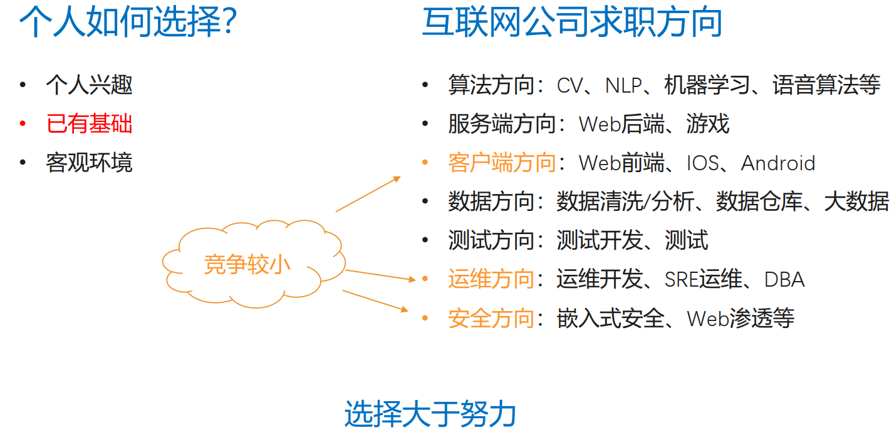
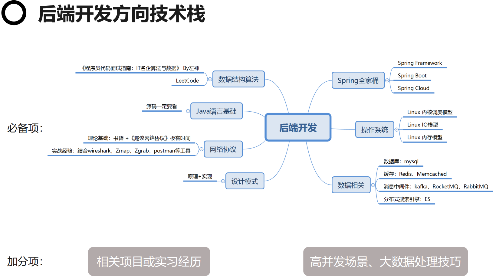
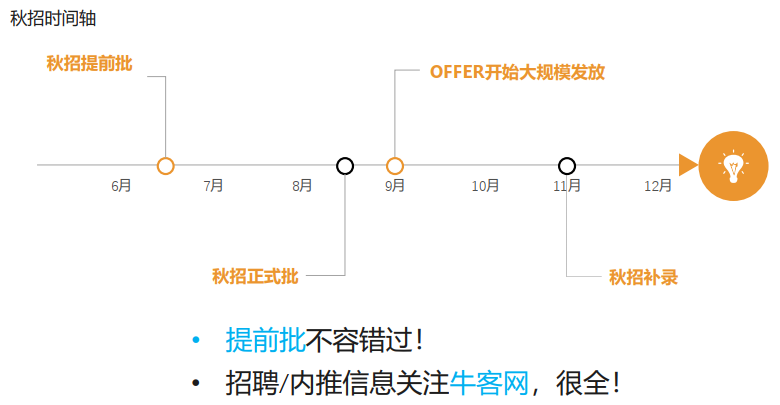
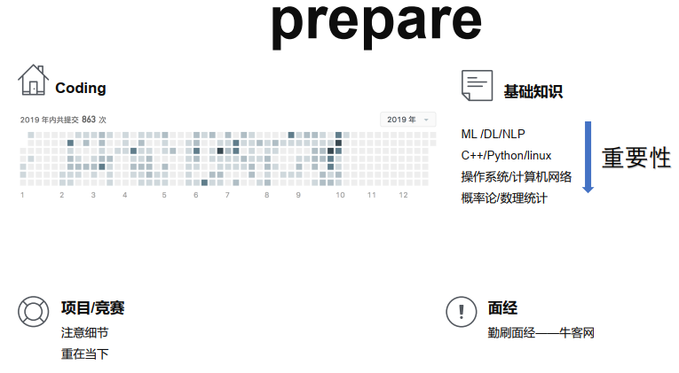
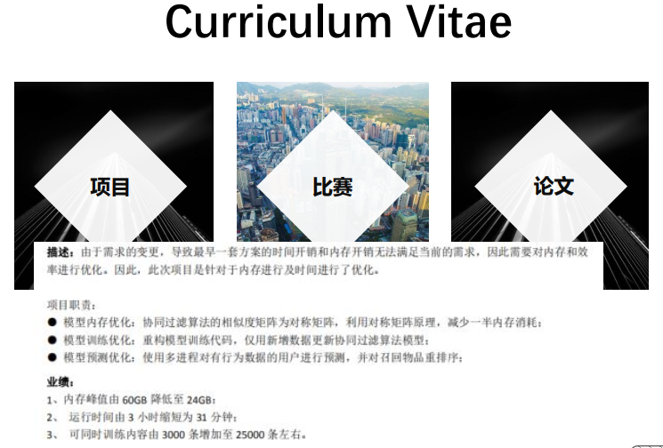
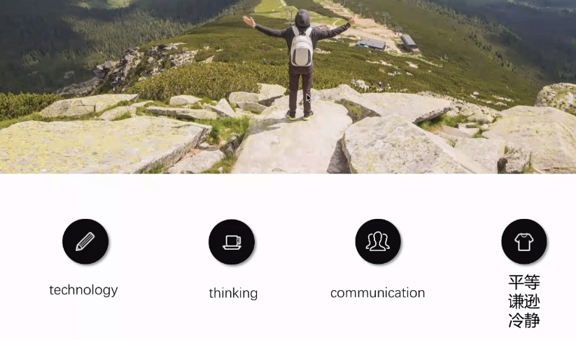
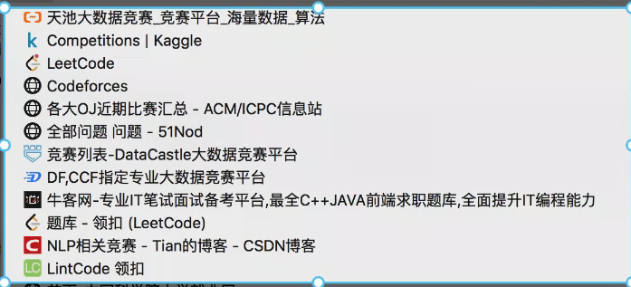

<!-- MarkdownTOC levels="1,2,3" autolink="true" autoanchor="true" -->

- [硕士秋招求职经验分享-后端开发与NLP算法方向](#%E7%A1%95%E5%A3%AB%E7%A7%8B%E6%8B%9B%E6%B1%82%E8%81%8C%E7%BB%8F%E9%AA%8C%E5%88%86%E4%BA%AB-%E5%90%8E%E7%AB%AF%E5%BC%80%E5%8F%91%E4%B8%8Enlp%E7%AE%97%E6%B3%95%E6%96%B9%E5%90%91)
    - [收获小结](#%E6%94%B6%E8%8E%B7%E5%B0%8F%E7%BB%93)
        - [前期准备](#%E5%89%8D%E6%9C%9F%E5%87%86%E5%A4%87)
        - [简历撰写](#%E7%AE%80%E5%8E%86%E6%92%B0%E5%86%99)
        - [面试过程](#%E9%9D%A2%E8%AF%95%E8%BF%87%E7%A8%8B)
        - [offer 选择](#offer-%E9%80%89%E6%8B%A9)
    - [Java 后端开发方向-2017级硕士王旭](#java-%E5%90%8E%E7%AB%AF%E5%BC%80%E5%8F%91%E6%96%B9%E5%90%91-2017%E7%BA%A7%E7%A1%95%E5%A3%AB%E7%8E%8B%E6%97%AD)
        - [牛客2019.11月文字版面经](#%E7%89%9B%E5%AE%A2201911%E6%9C%88%E6%96%87%E5%AD%97%E7%89%88%E9%9D%A2%E7%BB%8F)
        - [求职方向选择](#%E6%B1%82%E8%81%8C%E6%96%B9%E5%90%91%E9%80%89%E6%8B%A9)
        - [后端开发方向技术栈](#%E5%90%8E%E7%AB%AF%E5%BC%80%E5%8F%91%E6%96%B9%E5%90%91%E6%8A%80%E6%9C%AF%E6%A0%88)
        - [如何投递](#%E5%A6%82%E4%BD%95%E6%8A%95%E9%80%92)
    - [NLP 算法方向-2017级硕士张悦阳](#nlp-%E7%AE%97%E6%B3%95%E6%96%B9%E5%90%91-2017%E7%BA%A7%E7%A1%95%E5%A3%AB%E5%BC%A0%E6%82%A6%E9%98%B3)
        - [牛客2019.11月文字版面经](#%E7%89%9B%E5%AE%A2201911%E6%9C%88%E6%96%87%E5%AD%97%E7%89%88%E9%9D%A2%E7%BB%8F-1)
        - [前期准备](#%E5%89%8D%E6%9C%9F%E5%87%86%E5%A4%87-1)
        - [简历准备](#%E7%AE%80%E5%8E%86%E5%87%86%E5%A4%87)
        - [面试技巧](#%E9%9D%A2%E8%AF%95%E6%8A%80%E5%B7%A7)
        - [offer 选择](#offer-%E9%80%89%E6%8B%A9-1)
        - [Q&A](#qa)

<!-- /MarkdownTOC -->

# 硕士秋招求职经验分享-后端开发与NLP算法方向

## 收获小结

### 前期准备
1. 求职方向选择【选择 > 努力】：自我分析（个人兴趣+已有基础+客观环境）+ 岗位分析（公司类型+求职方向）
2. 确定必备的技术栈：可根据岗位需求准备相关基础知识
3. 数据结构和算法-刷题：无论博士硕士，只要是面互联网公司，都需要进行 coding 面；每天刷2-3道，每2周总结，面试前一个月最好每天刷5-10道
4. 项目竞赛论文：围绕岗位需求，做一些相关的项目or竞赛or论文
5. 勤刷面经-牛客网：一则检验上述基础知识和算法编程等的复习效果，二则熟悉面试流程
6. 求职时间安排：7月左右提前批大量出现；6月初or最迟6月底需要完成简历第一版，后续每周持续更新一版；5月底or最迟6月底需要完成基础知识和刷题的准备

### 简历撰写
论文、项目、竞赛是关键。

1. 表达简练、结果量化、突出重点
2. 适当润色：如果当时由于时间限制没有采用一些更好的办法，后面有时间了，使用新的方法重做效果更佳，也就可以写到简历中，凸显能力；但一定要做，不能造假。
3. 针对不同的岗位，建议准备不同版本的简历

### 面试过程
面试重点考察：

1. Technology ：与岗位匹配的基本技术
2. Thiking ：面试者的思维方式、逻辑、解决问题的能力
3. Communication : 与面试官沟通、表达的能力
4. 态度or情商：平等（面试是一个双向选择的过程，无需把自己放得很低）、谦逊（面试官可能在你研究的领域并不很懂，问了naive的问题，不要表现出嘲讽）、冷静（有些面试官会故意在面试过程中进行压力面，diss你，一定要保持冷静）

### offer 选择
1. 选定目标：确定面试顺序，对offer进行分级；给了offer也不会去的->公司的普通部门->重点公司的重要部门
2. 多多调研：公司、部门相关信息如技术氛围、加班情况、各个组内的大佬情况、怎么晋升、以及业界的认可度等等
3. 学会 argue ：多面公司，多拿offer，互相battle

## Java 后端开发方向-2017级硕士王旭

### [牛客2019.11月文字版面经](https://www.nowcoder.com/discuss/331574)

### 求职方向选择

1. 个人建议不要过多的倾向个人兴趣，因为应届生求职的第一份工作的方向，很大程度上决定了以后的求职方向；应届生求职的时候，不会过多的看中项目经验，而是看你的基础；但是在社招的时候，项目经验是很重要的；所以在选择的时候要慎重，如果仅仅根据你的个人兴趣来选择，以后每天都在做这个工作，以后可能你的兴趣会逐渐丧失，变得十分枯燥。所以感觉还是从个人的客观已有基础来进行选择，比如说个人比较擅长于某方面，比如说如果比较擅长想一些新的点子可以从事产品方向，比较喜欢落地的可以从事算法方向，比较擅长挖漏洞从事安全方向等
2. 整个求职方向中技术岗的竞争压力，根据20届秋招的情况看，客户端、运维、安全这三个方向是竞争压力比较小的，在补录的时候公司大多是针对这三个方向进行补录，算法方向特别是CV是非常火热的，主要是很多非计算机科班的同学，比如说数学、通信、自动化方向的，都会来投递CV方向，不仅要和计算机的同学竞争，还要和非科班的同学竞争，压力就比较大了，服务端相对算法竞争小点，但比其他的又大一些。很多时候选择的方向，很大程度上决定了你应聘的结果，可能付出同样的时间，但结果差距较大，所以选择方向的时候需要慎重一点。

### 后端开发方向技术栈

后端开发方向是一个比较杂的方向，需要准备的东西是非常多的。

1. 数据结构算法：只要是技术岗，可能除了安全岗考得比较少以外，其他的服务端、数据、测试等这个是必考的。而且每一轮面试（一般面试3-4轮）都会出1-2道题，一个公司面下来至少会考4-5个题左右，所以这个东西是必准备的。准备的过程中，除了研一开始刷题之外，研二的时候发现了《程序员代码面试指南：IT名企算法与数据》BY左神 这本书，把互联网面试过程中的180道高频题都罗列出来了，从我们的面试经历来看，把这180道高频题完全过一遍，熟练掌握（不光能做原题，变种题也能做出来），基本应对面试就没有什么问题了，而且里面会给出一些最优解的算法，想到的一些算法也都会列出来，比较全面，建议看一下。除了应试的准备看这本书之外，平时的练习也比较重要，Leetcode，从研一到研二找工作期间刷了400+题，对校招的面试来说足够了，刷题的时候不要贪多，刷到3/400道的时候，这个时候总结是更重要的，特别是高频题，总结其中的套路。
2. Java语言基础：面试java后端方向，那java语言基础一定要掌握，也是面试过程中着重考察的点。根据面试的经验来看，准备的时候，源码一定要看，因为面试过程中，面试官如何考察你java的掌握程度，往往就会问java中某个包or某个类的源码是怎么实现的，做了哪些优化，这样才能比较好的区分开，对java语言的掌握比较深还只是说粗浅的使用。建议在看的过程中不要单纯的啃源码，那样会比较类，也没有头绪，可以借鉴一些前人已有的博客（但要注意筛选，有些博客自己就写得不对），看完博客再去看源码，这个时候反而有种事半功倍的效果。
3. 网络协议：面试java后端方向，对网络协议也是要有一定掌握程度的。建议是，书籍一定是要看的，TCP/IP，计算机网络那本书，当时还看了一本极客时间的课程《趣谈网络协议》比书上讲得有意思一点，书的基础掌握得差不多的时候，可以看一下这本书，是一个笔记，把网络协议举了各种生动形象的例子来讲。看得过程中，觉得理论基础准备得差不多了，可以借鉴一些工具进行抓包分析的实战，因为面试官不可能只问一些基础知识，肯定会问一些实际的使用经验，这样会比较有底气一点。
4. 设计模式：这个基本上每个公司都会问，面得过程中可能会问一些比较高频的设计模式，而且问的时候不会让你单纯的在那讲， 会让你自己去手写实现，所以在准备的时候，除了要理解它的原理之外，一定要手写实现。另外，在准备算法的时候，也不要单纯的只在电脑上敲，因为在电脑上写和纸上写是有差距的，一定要用手去写，手写之后，印象会加深，而且在面试过程中，基本上都是手写。如果习惯在电脑上敲，一旦面试给你张纸写，会很不适应。所以在准备这些的时候，都要手写练一下，基本上练个1-2天，就够了，在纸上写和在电脑上敲就没什么区别了。
5. Spring全家桶：既然面得是java后端，spring是必会的，无论是framework原始框架，还是后来的boot，以及现在的 RPC 框架 cloud 都是要了解的，前面两个必须要牢牢掌握，最后的cloud如果时间不够，可以先粗浅的看下，但建议还是要掌握下最好
6. 操作系统：以上6点基本上是每个公司都会问的；准备的时候可以从 Linux 内核调度模型、IO模型、内存模型这三点去准备就足够了
7. 数据库：mysql这个基本上也是必会的了，毕竟是做后端开发，是要和数据库打交道的，比如mysql里面的事务、它的隔离级别、它的脏读换读不可重复读与隔离级别关系及实现原理、如何用锁来实现的、索引实现的原理、以及它的日志、mysql有两个日志、数据表的主从备份、分库分表实现，也是需要准备的；后面缓存、消息中间件、分布式搜索引擎ES这种，如果实在没有时间准备，优先级没有前面高，但建议还是尽量准备，而且建议在项目中也尽量使用这些东西，算是一个加分项吧，如果没有在面试时会弱势一点。缓存的实现方式，redis如何做持久化的，redis如何使用哨兵架构解决主从架构更新的问题；后面两个理解得不够深，会使用也是OK的。
8. 加分项：相关项目or实习经历，java相关的项目是一定要的，项目的好与坏就是加分的程度了，项目的难易程度，以及个人在里面占的重要程度，以及掌握程度，就是加分项了；实习经历不是必须的，不是说写了一个大公司的实习经历就能够加分了，这个还是看个人自身来决定的，如果实习的过程中，单纯的仅仅是满足实习公司里mentor给你布置的任务，做一个简单的CRUD boy，那这个实习和你没有实习是没有什么区别的，但是如果你在实习过程中，遇到一些高并发的业务场景，对这些场景，做了一些深入的思考，得出了一套比较完善的思维体系，感觉是比较好的。所以不要认为没有实习经历就不行，有了实习经历就肯定行，这个是没有什么关系的，还是要看个人自身。但是项目这个是一定需要的。
9. 加分项：高并发场景、大数据处理技巧。高并发场景这个如果没有实习基本上接触不到，所以如果有，肯定是比较好的，如果没有也不用太过担心；大数据处理技巧基本上每一轮面试的最后一两个问题都会问这个，这个还是需要准备一下的，比如说海量数据下的TopK的次数，筛选、去重、排序，以及如何在短时间内，对一些大量的请求和访问进行限流，以及大数据处理的一些方法，bloom过滤器、一致性hash，MapReduce这种，这个与是不实习没啥关系，还是可以准备的。
10. 前面准备的够好，拿个SP和SSP也是OK的。

### 如何投递

1. 秋招过程：基本上从6月中下旬就有提前批出现，去年是oppo or vivo，不过后面就没了，6.15左右会有1-2个公司。大规模的提前批还是在7月初开始，7月10号左右。提前批会从7月初到8月中旬，这部分都是提前批的面试，大规模的面试。8月中下旬到九月初正式批就开始了。9月份开始，提前批已经面完了，offer就开始大规模发放了，一直到10月中序左右。9月初发放的是提前批的offer，10月份开始发正式批的offer，一直到11月，这个时候秋招的提前批和正式批的offer就已经发放完毕了；从11月开始就开始补录了，这个时候补录的岗位基本上就是客户端、运维、安全方向，这几个方向投递的相对较少一般招不满，其他岗位也会有（有人毁offer这种）不过一般比较少。最后到12月基本上补录的offer也就发完了，秋招结束。
2. 个人建议：提前批一定要投，投了比别人多了一次机会；而且这么想，如果提前批没有投，9月份or8月中旬才开始投，这个时候如果9月份开始面，面第一家公司，可能面得不够好，很受挫，这时候发现别人开始大规模收割offer了，这时候心态可能就不够好，会崩了；而且提前批流程短，流程迅速，提前批基本上1天过去，或者1周，1-4轮面试就都面完了；除非提前批表现得极差，感觉你这个人，基本上没在这个方向待过，什么技术都没有，可能公司会在面试记录里给一个表现不太好的记录，影响正式批；哪怕是表现一般的水平，只是当时的表现与公司想要的有一定的差距，即使你失败了，也不太会影响你的正式批，除非极差，基本上不怎么影响，所以建议还是要投的。
3. 个人建议：招聘/内推信息关注牛客网就够了，有个讨论区的帖子，以及秋招的页面，就够了。

## NLP 算法方向-2017级硕士张悦阳

### [牛客2019.11月文字版面经](https://www.nowcoder.com/discuss/328830)

### 前期准备

1. 算法岗性质区分：找工作之前首先需要明确自己到底想要做什么，这三类的市场需求是依次递赠的，不确定性的产出是依次递减的，创新需求也是依次递减的，越往下就越偏向业务开发
    - Research 研究岗：面试的时候title就是 XXX 研究员，主要集中在大厂的研究院 or AILab 这种地方，但是大厂的技术部门也会有这样定位团队or组，而业务部门很少会招聘严格意义上的研究员，这种岗位比较注重学术前沿，也会适当照顾业务线的长线需求，打造业界影响力。主要以发paper为主，如果你确实比较想发paper，确实在发paper方面很有自己的一套的话，这样的岗位比较适合你。但这种岗位更多招的是博士，以及极少部分特别厉害的硕士
    - R&D 研发岗：主要集中在大厂的技术部门，大厂研究院也有可能会有这种定位团队，这种岗位重点在于攻克业务中的复杂算法问题为首要目标，研究成果一般是以专利or论文的形式发表。这种岗位应该是算法岗最普遍的一种岗位，包括研究和开发两个工作，不光是像纯研究那样，而是需要把自己的研究落地去照拂业务部门。以研究为导向。
    - Development 业务导向的算法工程师：主要工作就是为了解决实际业务中存在的问题，这也是最为典型的算法工程师，市场上招聘的，大多数都是以 development 为主，主要是在业务部门，比如说百度翻译，就是为了解决一个具体的一个翻译的工作，所有开发工作都是围绕翻译
2. Coding 面：整个19年大概 AC 了6/700题；如果 AC 300 题以上，应该能够应付普通的面试，如果你 AC 6/7/800 道题的话，就会发现，那些面试的题，都见过，很少有没见过的题，哪怕是没见过的题，也知道这个题的方法是你用过的， 然后往那个方法上去靠就行。战线拉最长的。首先要强调题量，另外刷题以专题的形式，每个专题刷50-100道，2周一复习。因为在第一遍做的时候，有些题想半天想不出来，这种题不用一直想，比如一道hard的题，30分钟没搞定，就放弃看答案。刷题速度最高峰一天10道，2周复习一次；平时也就一天1-2道，保持做题的感觉。从现在，每天2-3道，到面试前一个月（6月中旬）就要保证一天5-10道的刷题量，这是一个节奏问题。复习问题，很多题第二遍做的时候发现还是不会做，一定要勤复习，花一个周末，把刷的2周的100来道题，过一遍。过怎么过，看到这个题目之后，脑海里一下子就能知道该用什么解法，最优解法是什么，这方面非常重要。而且在做题的过程中，不仅局限于把这道题给AC出来，要去找这个题的最优解法，LC评论区有很多点赞数比较高的，都是一些比较优秀的解法，那些解法可以看，那是拓宽思路的重要路径之一。刷专题+题量+复习。另外在刷题的后期记得在白板上写，IDE上会写，在白纸上可能思路就会乱。这是一种能培养你对整体代码的一种逻辑过程，比如在IDE上写，自动补全、tab、换行等这种东西在纸上写会忘，如果发现写错了，啪啪啪删掉，加大括号什么的，也会比较影响面试官对你的评价，哪怕写对了，但你的思路是乱的。在白板上写是为了更好的培养做题的整体思路。Coding是一个比较常见的流程，应该贯穿你整个秋招
3. 基础知识：4月份到7月份，甚至到9月份应该干什么，准备基础知识。以下准备重要程度依次递减。
    - 算法关：当前算法方面CV精度已经很高，很难找，如果真的很喜欢深度学习这种算法岗，建议找机器学习ML和NLP，还有较多的应用落地需求。确定方向之后，就要准备ML/DL/NLP的基础知识（指能在书上or网上找到准确答案的东西），《李航-统计学习方法2》看得差不多，那ML就准备得差不多了；算法岗要准备的东西的确比开发岗要少，但是需要你很长时间的扎实的投入。这种基础知识准备过程中最重要的就是手推公式，所有基本的机器学习的算法，都要保证能够手推公式。深度学习公式主要集中在BP、SVM这些。NLP基础知识就很多了，不同的新生领域不同的基础知识也不同，但也有一些通用的，如词向量、各类损失函数、优化函数这些要懂，再根据自己要做的子领域，baseline是不一样的
    - 语言关：现在的算法岗，大多数都是线上是C++开发，线下是Python跑模型，需要熟悉linux开发环境。C++和Python这两个语言都还是要会的，linux的操作，在面试中也有被问到过（阿里和顺丰问过），就问起来一定要知道
    - 操作系统、计算机网络：如果前面两个已经花了很大的精力的话，这俩可以放一放；面了15家，只有1家（搜狗）考到了操作系统，1家考到了计算机网络
    - 概率论/数理统计：这类题属于智力题，尤其是二面三面，一面技术面一般不会考到，二面三面更多考验你的思维能力，思维方式or智商够不够。因为算法很多和概率打交道，这部分的题很多面试官还挺喜欢考的（美团、阿里、百度），也需要准备一下。不过重要性并不是特别高，这类题答不上来，并不是说不给你offer，只是说可能没有机会冲刺那种最高级别的offer。答不上来也就答不上来了，不会说你基础不扎实，有时候需要灵感
4. 项目/竞赛：
    - 注意细节：项目需要回顾，重拾起来。怎么捡，把之前的代码重新看一遍，可以运行就重新运行一遍，运行过程中需要思考，哪些是亮点（注意细节），哪些是这个项目比较关键，比较难的地方，一定要把它单拎出来。这里有个小技巧，解决这类问题，可能在当时没有用到某个技术，受限于当时的个人能力和知识水平，没发现or不知道有这么一种很好的技术可以解决，但是随着一两年的学习，发现现在有一个比较好的方法可以解决，那就可以把当时项目里的这个任务稍微给润色一下。
    - 重在当下：当时项目里真正做的东西，真正实现的东西，它是怎么实现怎么运行的，不那么重要，重要的是你现在又有了什么新的看法，现在又有了什么新的思路，可以把现在的看法和思路付诸于行动，去运行一遍，一定要把它做一遍，在你已经动手做完的情况下，可以把当时的方法，替换成现在的方法，这一点可以让你的简历提升不少。面试是面试这一瞬间掌握了多少东西，不是当时这个项目掌握了多少东西，所以只要是做了的，后来学会了，就可以往简历里面写
5. 勤刷面经-牛客网：如果前面几部分都准备完了，那最后就该刷面经了。每看一次面经，就相当于经过一次面试。在6月到7月，其他面试也没开，刷了大概50-80篇面经，那么在7月初面试的时候，就会觉得非常轻松，因为面试也就是那些套路，看多了之后也就发现套路是一样的。怎么检验看面经的合格程度，当你看完50/80/100篇面经之后，你随便点开一篇面经，你发现里面90%的题都是见过的，然后你都可以把他们答出来，那就说明你面经看合格了。

### 简历准备

简历需要包装，在这个大环境下，即使你把你所做的东西全写出来，面试官也都会认为你是经过包装的。包装、更好的去营销自己已经成了一种趋势。不包装的话，面试官再砍30%，那就不剩什么了。

对于公司来说，招人的目的只有一个，就是能够快速接受并很好完成这些工作。如何通过简历知道一个人是否能够胜任or符合企业的预期呢？很大程度上就是看你的项目经历。如果项目经历与当前的业务需求匹配程度越高的话，被筛出来的可能性就越大，但这个可能更多的适用于社招。这就是为什么校招的第一份工作确认下来，后面社招就不好换了，除非考公务员。因为社招很看重你的项目匹配程度，而校招，因为学生在学校里面所做的项目和工业界所做的东西其实是非常大的，所以它不会过多的去关注你之前所做的东西，但项目、比赛、论文这三方面对于求职来说，尤其是算法来说，这三方面是必不可少的，可以不突出，但只要你有一个从0到1的这么一个东西，从0到1这个阶级度一定比从1到2要大。

简历中的项目和论文研究方向是否相关，如果都是在一个大领域下的话，说明研究还是比较深刻的，也能体现出钻研能力。对于这样的同学，即使他的简历项目与公司做的东西，有一定出入，也有很大概率获得面试。意味着在面试不同公司不同岗位的时候，准备多份简历（个人准备了2份）。企业中比较喜欢打比赛的同学，只要是正儿八经打过比赛的同学都知道，虽然大多数套路是一样的，经过一次比赛下来对很多模型和算法有一些新的认识，而比赛的题也是企业中真正面临的问题，如果你能够很好的解决比赛中的问题，那么有很大概率你也能更好的解决企业中遇到的问题。如果说论文发得好是偏research岗的话，那比赛和项目做得好就对R&D以及development岗具有很大优势。

如何在简历中体现出来？
很多同学犯了一个错误是在简历中把项目经历，写成了项目简介。
真正的项目经历应该包括哪些部分：要告诉面试官，自己曾做过哪些项目，解决了什么问题，在这个过程中用到了什么算法模型，项目的指标提升了多少（最好可量化，这点非常重要），有什么突出的业绩。这才是一个项目经历，而不是项目简介。

从第一版改到最后差不多改了20版，一直不停的在迭代，最后改完对比，第一版啥也不是；所以也不要以为简历一写完就OK了。简历应该在5月底完成，一直到9月份甚至到10月份，应该保持一周一改的速度，然后就会发现，后面的面试，越来越简单，后面获得的面试机会越来越多，就是因为简历质量上去了。

### 面试技巧

1. Technology 技术：检验专业技术是否过关，项目、算法是必不可少的，但不同公司不同职位又有不同的侧重，但是具体的专业技术考核是肯定要的，是敲门砖，能保证你第一轮面试可以过。除此之外，除了显式的面试考核以外，还有很多考核是隐式的。很多面试者自己认为自己面得还可以，但是最后没有过，那很可能是他面试官问的问题都答上来了，但是可能他思考和沟通交流这边欠缺了。在一场面试中，面试官只用得到一个问题的答案，和你一起工作，开不开心。是否开心就体现在这三方面，技术够不够硬，如果这三方面都可以给一个比较好的反馈的话，那就会给一个比较高的分。
2. Thinking 思考问题的方式
3. Communication 交流方式

面试的正确姿势。面试就是提出问题，回答问题，在你来我往的交流中呢，模拟实际的工作情形。当面试官抛出一个问题的时候，我们应该如何很好的完成一个对话。不管是具体的算法or项目问题，面试官向你抛出问题，往往是开放的，没有非常清晰or严格的正确定义（大多数情况不会问那么死）。首先，就是要尝试复述面试官的这个问题，用自己的语言去理解、确认面试官的问题，因为对有些问题没有一些清楚的定义，可能会有一些模糊地带，是一定是需要和面试官去确认的，如果这些问题比较清楚的情况下，就可以去提出一个清晰的解决方案，哪怕这个解决方案是非常naive的，只要能运行，能得出结果，那就是OK的，大胆的说出自己觉得可行的方案，哪怕这个方案看起来非常的简单。只要是能够解决这个问题的方法就是好方法，不需要去考虑什么流量问题、负载均衡这些问题。可以先抛出一个最初步的想法，然后如果你遇到的是一个很厉害的面试官，他会一步步的引导你，你这个问题可行性怎么样啊？你这个问题是不是需要考虑A问题B问题C问题啊，这个时候就要去和面试官不断的交流，你不断的解这个问题的过程中，面试官就能够看出你是一个非常勤于思考。

1. 正确的理解问题并复述
2. 清晰问题是什么
3. 提出一个可行的解决方案
4. 讨论：和面试官讨论出一个较优的解决方案
5. 实现：针对一些代码的时候
6. 测试

个人建议：

1. 技术该怎么准备，怎么算准备合格？——你能够把某一个知识点，给你的一个朋友，可能是相关领域的，给他讲明白，那就是合格的。因为在面试过程中，很多面试官做的领域不一定和你是一样的，可能根本没有接触过你的领域，怎么能说明自己能清楚的讲出来呢？事先跟朋友相互介绍一下，如果他能听明白，那面试官一定也能听明白。这个是检验你是否能够讲清楚项目的最直白的方式。
2. 怎么在面试过程中体现出自己思考能力？——一种是对开放问题的思考，一种是代码题也在观察你的思考能力。当你LC刷了4/500题，他抛出一道题出来，你发现你做过，你不用马上把最优解法给出来，一定要假装一下，说要想一想，但也不要想太久，然后再把解法抛出来。不要立刻喜形于色，啪啪2分钟写出来，那面试官肯定知道你这道题做过，不要这样，一定要深藏不露。这个题，思考一下，思考3分钟，有idea了，把代码写出来，这才是最好的结果。这个不仅适用于代码面试，在开放性问题中也是这样的。这就是一种面试技巧，哪怕这题你做过，也不要去很快表现出来。第二个考察是否再思考，就是你有没有去引导面试官，给出解法之后，在面试官检查的时候，也还可以继续抛出自己的想法，给面试官比较好的印象，你时时刻刻都在思考。尽量在面试过程中体现这方面的能力。
3. 交流关键在平等、谦逊、冷静
    - 面试是一个双向选择的过程，并不是面试官单向考核的过程，没必要姿态放那么低，就单纯的技术交流，放在一个平等交流的层面上，这样的话，至少你在说话的时候你是自信的，回答问题的时候也不会有那么大的心理负担；
    - 保持谦逊，很多面试官跟你做的不是同一个领域的，面试官知道的东西不一定比你多，有时候可能会问出一个比较尴尬or naive的问题，这时候不要摆出一副这题不就是这么做肯定这样做的姿态，不要这样，好好的保持谦逊，我为什么这样做，最后可以加一句，你提的这个问题我的确没有考虑到，我回去可以试一试，哪怕你心里知道这个技术方案简直就是垃圾，但也不要这么说，保持谦逊；
    - 遇到不会的问题的时候，不要慌；有些面试官很烦，会给你一些心理上的压力，干扰你的思路，但是你需要保持冷静。虽然冷静不是那么好容易保持的，只是说你需要有意的去培养这方面的感觉，哪怕答不上来也无所谓。
    - 最后在整个交流过程中，还是要体现出一部分自信，一部分做事的态度。面试官为什么上来需要你做几分钟的自我介绍，主要是可能很多面试官没时间看你的简历，需要在你介绍的时候，把你的简历过一遍，找到可以提的问题的地方。所以在面试的过程中，尽量你去把握话语权，就是你说的东西一定要比面试官说的东西多，面试官问你问题，一两句话就说完了，这个是一定要避免的。
    - 最后特别是中科院的同学去面试，情商还是要高一点：因为确实中科院人比较多，校友遍布，你会发现很多面试官都是中科院的校友，有些面试官一上来会跟你套近乎，诶，你是中科院的，啊啊是，你是哪个所的，我也是中科院的，啊你好你好师兄好师兄好。面试官都主动跟你套近乎了，你难道还不主动去跟他套近乎吗？

### offer 选择

1. 选定目标：这个目标不仅是最终的offer选择的时候的目标，更多的时候体现在你投简历的时候，你的目标是什么。现在回想起来在投简历的时候，有一些战略战术上的错误；很多公司它真的只接收一轮简历，虽然他们宣传的时候是说，提前批不影响正式批，提前批投了之后正式批还是可以投，但其实你所有的面试记录，都会保留在他们的系统中，你第一次面试得不好，如果显示的就是一个差评的话，那么第二轮哪怕你有可能进面试，也有可能被刷掉。所以这个时候就要去把握，什么时候投简历，也是一门艺术。比如说这15家中有很多是我投了也没打算去，就是想蹭个面试经验，比如说京东、追一、搜狗、顺丰，这些公司投了也没打算去，就是为了刷经历。如果你这些经历已经刷到一个比较高的层次了话，那么你再去投你真正想去的公司的时候。投简历就跟高考填志愿一样，首先要有保底的，这些公司，拿了offer之后，我去，心里不会有太大落差，一旦有保底offer之后，接下来就要冲刺一些非常想去，非常厉害的一些公司和部门，因为对于同公司不同部门之间的差异，比不同公司之间的差异都大（比如说阿里市值那么高，但除了那几个非常难进的部门外，其实进阿里难度不是那么高，阿里淘系、阿里云这些岗位可能难度稍微大一点，其他岗位可能没有那么大，稍微简单点）。但如果有了保底offer之后，是否应该去冲击一下最想去的部门，比如说阿里妈妈，阿里最大的现金流部门，百度的搜索，字节的抖音，美团的外卖、到家、到店，就是那些现金流部门，一定是这些公司最难进的部门，因为它是利益最大的部门，包括腾讯的微信。你说这些公司其他部门好进吗，相对来说，没有那么难。只有这些明星部门是最难进的，当你一旦有保底offer之后，就要考虑是否要去投这些公司的明星部门了。但是你一定要做好被刷掉的准备，这些部门真的是神仙打架，尤其是算法这边。这时候在选定目标的时候，首先需要确定的是面试的先后顺序。哪些公司是用来刷经验的，有些公司可能面不过他们最核心的部门，可以选择不那么核心的部门，但是这家公司的评价比较好。因为很多公司投一次挂了之后，很难再被捞起来，除了字节那种很缺人的，动不动捞你5/6次，其他的挂了之后，你想再投就很难了。这类公司，如果没有保底offer的话，最好选择一个不那么火的部门，当拿到这些offer之后，下一批就要冲刺一些更好的部门。这里个人比较遗憾的是美团和阿里的offer，开的薪资还可以，但是确实部门不是那么想要的，最后就放弃了。所以最后即使拿到offer，其实部门的满意程度，也极大影响了你offer的选择。投简历的三个步骤：先投一些最不可能去的公司纯刷经历，其次刷一刷想去的公司的普通部门，最后刷一下那些非常牛的部门，这样能够保证你的offer是有梯度的，最后在选offer的时候也能有比较明显的界限。
2. 多多调研：主要是值技术氛围，加班情况，各个组内的大佬情况，怎么晋升，以及业界的认可度。调研的时候薪资可能不是那么关系，因为有些同学可能想要户口。户口这个东西，如果想要去互联网公司拿户口，其实非常非常难，尤其大厂，阿里的北京户口随机分的，腾讯的户口是排序的，大多数公司户口都是排序的，公司越大，牛人越多，排上户口的可能性越小，但是如果你对户口有执念，又不想去国企拿户口，那么这时候哪些互联网公司比较好拿到呢？那种比较小而美的公司，举个简单例子，搜狗、陌陌、360、小米，这些公司其实也挺大的，只是说没有头部公司这么大，但是它有户口名额，如果你能够在它所有的人里面排前面，最后面评前5的话，很大概率可以拿到户口。给一些想要拿户口但是又不想进国企银行拿户口的同学，可以去一些二线、三线的公司拿，它有户口名额，而它的面试难度没有那么大，如果个人软素质比较强，面试面评又比较高的话，面试评分是很容易去拿到一个比较高的批次offer。校招应该选大平台还是高薪资，这点因人而异，如果是想去钱多的公司，拿这几个公司一定要去面，拼多多、依图（总包65w）、猿辅导、字节，这些公司开的base都比较高，但是他们加班也的确比较严重（除了猿辅导以外，它比较有钱），有时候，看到最后薪资也没那么重要，不过这个因人而异，多多调研是有好处的。
3. 学会argue：argue就是指拿到offer之后，学会抬价，抬价这个也没什么好说的。为什么建议大家多面公司，argue就是看你offer拿多少，你想去阿里，或者用百度argue腾讯，腾讯argue阿里，这些公司都是需要相互argue的，不要在面完2-3家公司拿到比较好的offer之后，就结束了你的秋招，这一点其实不太好，你可能拿到比较满意的offer，但是薪资水平是不是最高水平的薪资呢？如果是最高批次的，你不想去面其他，其实最高薪资从来都是上不封顶的，美团的北斗计划最高可以开到70w，拼多多和依图也能够开到60多，美团还给户口，但是美团同样北斗，有50w的薪资也有70w的薪资，就是通过你的硬实力，比如你的论文发表情况，你的项目经历，二真的是通过你offer拿的情况，能拿到腾讯的大咖，能拿到阿里星、华为星，去argue美团，你就是能上不封顶，一直往上。所以只要秋招没结束，大家就都可以尽量多投一些部门，多拿几个，最后能够给你的薪资待遇，年薪少则上涨2-3万，多则可能就十几二十万，所以不要为了偷一时之懒而少面几家公司，在我现在看来是不应该的，如果实在觉得面不动了，也无所谓。
4. 最后选择的过程也是看运气，赌一把，大公司、高薪资、户口都想要，也不是不可能，虽然概率比较小，看你敢不敢冒这个风险。到底是求稳，还是赌一把。

### Q&A
1. 博士找工作建议？——一定不要遗忘掉 coding 能力。可能外界看来博士更强调在某一领域的深耕，注重paper发表。现在很多互联网公司，招博士进来，可能你代码能力弱一点，但是还是会考察你的代码能力。不能在其他方面给很多建议，但是希望你们在coding这方面，能够一直坚持一直培养下去，这方面是非常重要的。那两个博士也跟我说，他们平时不怎么写代码，也就是跑跑深度模型的代码，调调参，那些数据结构、算法可能都没有接触过，一旦面试就只能临时抱佛脚，但是这东西临时抱起来可能也只是遇到原题会做，一旦变种一下就不会了。所以建议一定不能抛弃coding能力，可以去刷 Leetcode 等。当然 paper 能力也是非常重要的。——补充一下，现在不管是博士还是硕士，不管面试什么岗位，现在都要 Coding 面，只要是技术岗，哪怕是非算法岗也是需要的
2. 竞赛相关资源从哪里找？

