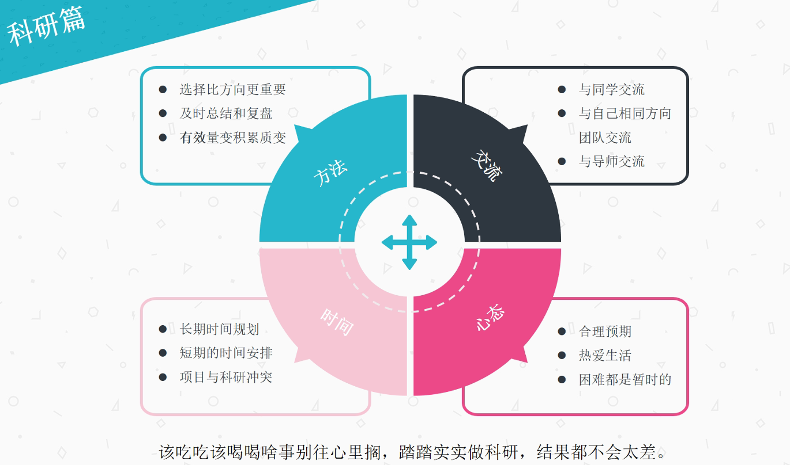
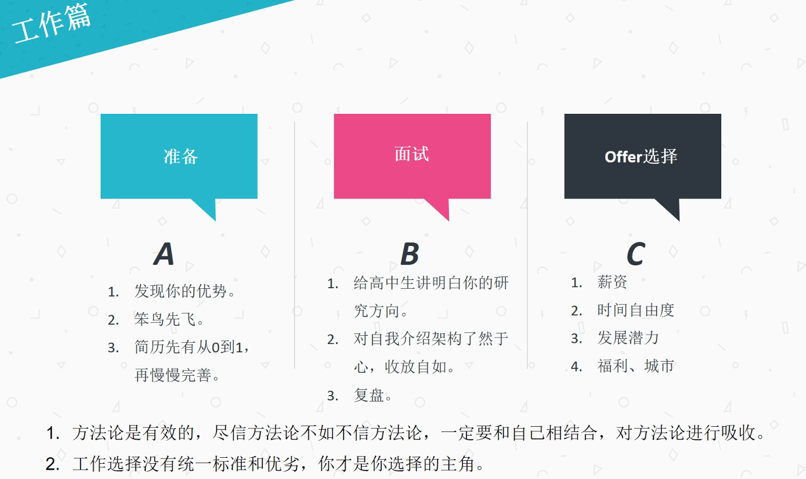
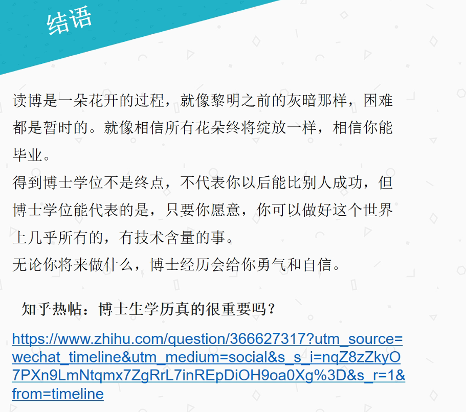
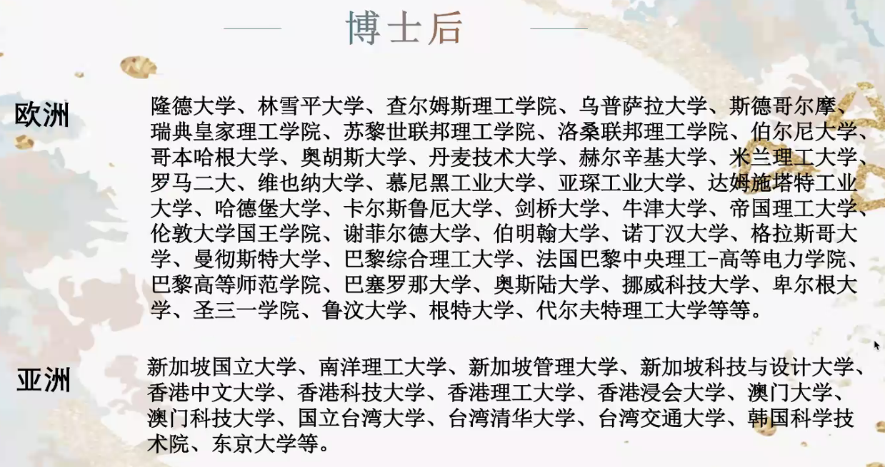
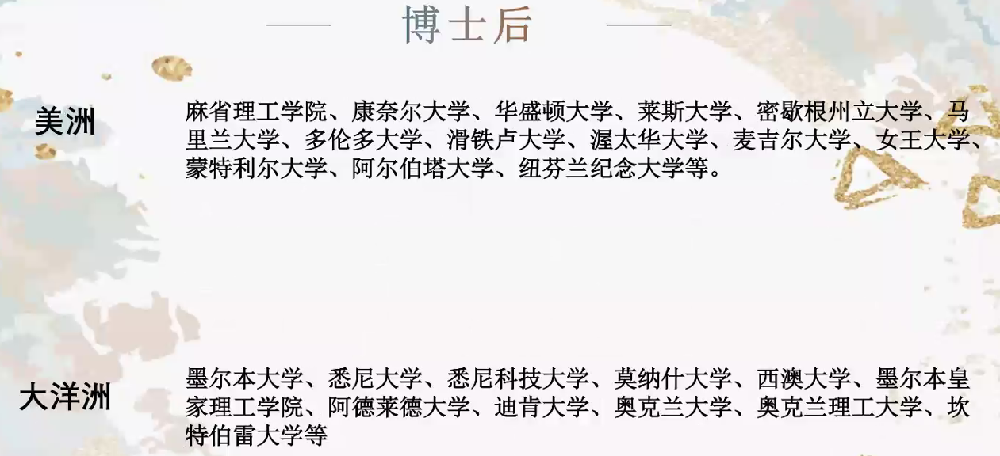
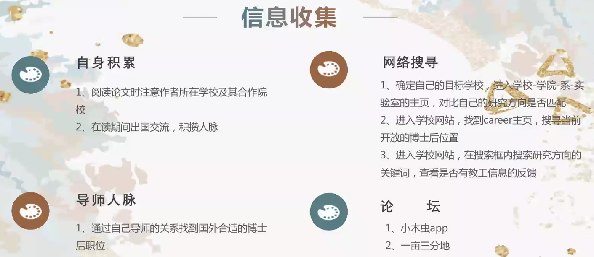
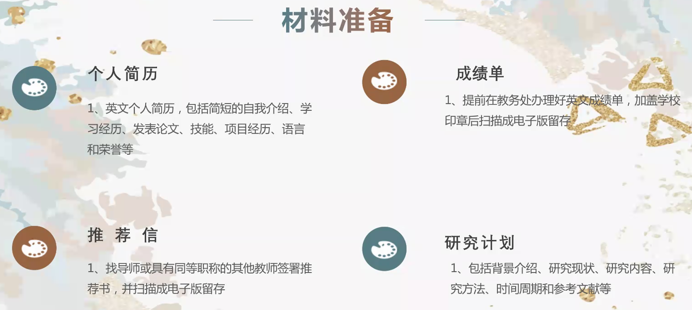
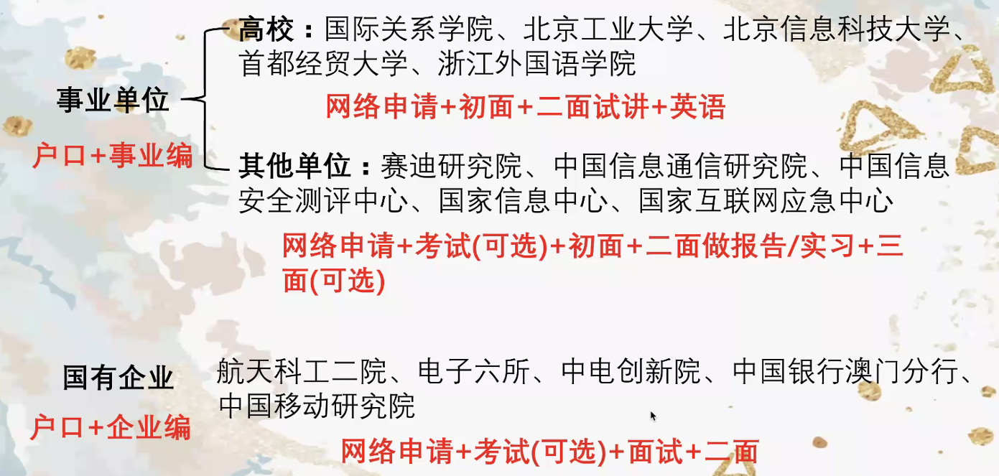
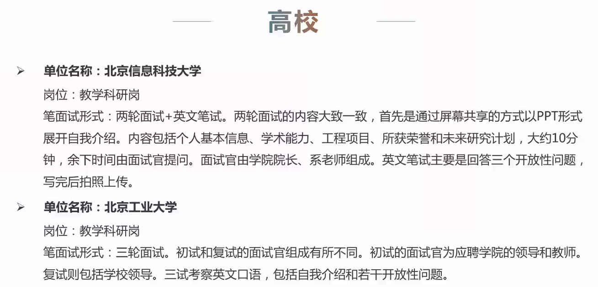
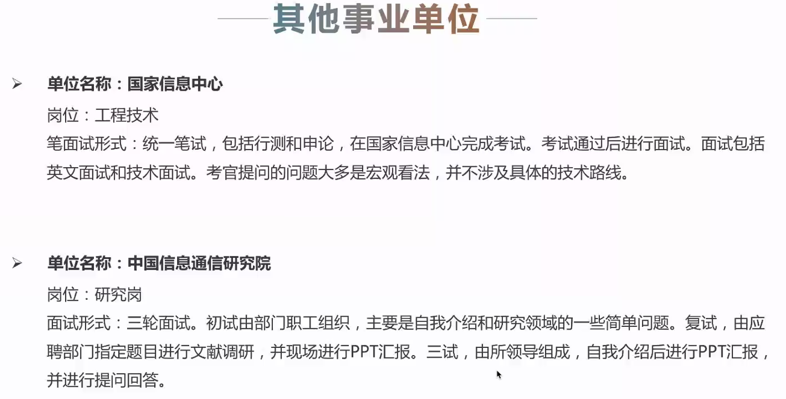

<!-- MarkdownTOC levels="1,2,3" autolink="true" autoanchor="true" -->

- [博士求职经验分享](#%E5%8D%9A%E5%A3%AB%E6%B1%82%E8%81%8C%E7%BB%8F%E9%AA%8C%E5%88%86%E4%BA%AB)
    - [收获小结](#%E6%94%B6%E8%8E%B7%E5%B0%8F%E7%BB%93)
    - [读博工作经验分享-2015级直博张巧遇](#%E8%AF%BB%E5%8D%9A%E5%B7%A5%E4%BD%9C%E7%BB%8F%E9%AA%8C%E5%88%86%E4%BA%AB-2015%E7%BA%A7%E7%9B%B4%E5%8D%9A%E5%BC%A0%E5%B7%A7%E9%81%87)
        - [科研篇](#%E7%A7%91%E7%A0%94%E7%AF%87)
        - [工作篇](#%E5%B7%A5%E4%BD%9C%E7%AF%87)
        - [结语](#%E7%BB%93%E8%AF%AD)
        - [Q&A](#qa)
    - [博士后/事业单位求职经验分享-2015级硕博赵博白](#%E5%8D%9A%E5%A3%AB%E5%90%8E%E4%BA%8B%E4%B8%9A%E5%8D%95%E4%BD%8D%E6%B1%82%E8%81%8C%E7%BB%8F%E9%AA%8C%E5%88%86%E4%BA%AB-2015%E7%BA%A7%E7%A1%95%E5%8D%9A%E8%B5%B5%E5%8D%9A%E7%99%BD)
        - [博士后](#%E5%8D%9A%E5%A3%AB%E5%90%8E)
        - [就业](#%E5%B0%B1%E4%B8%9A)

<!-- /MarkdownTOC -->

# 博士求职经验分享

## 收获小结

## 读博工作经验分享-2015级直博张巧遇
更注重个人经验和心得，不会讲通用的方法论，多思考，结合自身情况。

问题：
有两个问题：
1. 请问一下巧遇，求职过程中投递了哪些单位？哪些拿到了offer？最终选择的单位？——留所了
2. 请问两位在博士求职面试中感受到的，不同类型用人单位看重能力的区别？比如说事业单位、科研院所、互联网？

### 科研篇

选择比方向更重要：不要急于求成，在之前多花时间思考、选择

1. 研究方向
2. 研究方法

及时总结和复盘：保证自己的选择（方向、方法）没有跑偏（纠结细节）

1. 忘记自己为什么要做
2. 低谷期（困难），不愿面对，这时候更应该复盘

有效量变积累质变（发paper）：

1. 不要假装很努力（方向错了）
2. 提高效率

交流：不能闭门造车，容易陷入陷阱

1. 与同学交流：梳理自己思路，给别人讲清楚，跳出陷阱
2. 与自己相同方向团队交流：多看别人的论文，跟踪进展，保持前沿，容易写 introduction
3. 与导师交流：转换被动心态，不是给导师做汇报（做任务）的心态；而是主动的汇报自己当前遇到的困难，借助导师已有的经验，寻求一个建议

时间规划：要在一个领域做好，时间是一个必要的成本

1. 长期时间规划（1年+）：写论文的周期，deadline
2. 短期时间安排（天）：在长期的基础上，怎么赶，尽量避免熬夜，少熬夜；要有固定的科研时间，不要被其他事情干扰，它的时间优先级第一，以保证持续有效的科研习惯，非常有利；需要有锚，比如无论如何都要去跑步，无论遇到什么困难or心态，都会认为自己可以搞定
3. 项目与科研冲突：时间肯定是冲突的，项目和科研match比较难，可能刚开始匹配，后面不匹配；调整心态，如果不做这个项目，时间用来做什么，如果把拒绝项目的时间用来玩，肯定不好；对科研的精力消耗要大于项目，所以需要有一段时间科研项目的优先级最高；精力最好的时候做最难的事情，行政方面的事情，留给边边角角的时间。

心态：有没有一个阶段，自己的研究没有意义，什么研究都在打空气？——在研究了一段时间后，没法论文前，这是一个常态。心态很重要，读博无所谓，别心态崩了。读博也只是一个选择，不是一定要完成的事。心态要放平。

1. 合理预期：对读博过程、结果的一个预期。你能进我们所，说明你也不是很差。即使不能成为科研大牛（天时地利人和），为科研添砖加瓦也是可以的（传统的方法），只要踏踏实实的保证科研时间、去做综述、去发现问题、解决问题，也能够发论文，也能毕业。合理预期，成不了科研大牛，那就顺利毕业呗，只是一个时间早晚的问题，只要你踏踏实实的做。
2. 热爱生活：千万不要为了科研，不运动了、不谈恋爱了、不玩兴趣爱好了……该 social 就要 social ，该干嘛干嘛。
3. 困难都是暂时的：如果逃避困难、躲避困难，那困难就是永久的。只要踏踏实实的去做，困难就是暂时的。

### 工作篇

准备

1. 发现你的优势：找工作一定要基于你自己的优势去找，如果你看你自己和别人没有差别的时候，说明你没有发现你自己的优势。用自己的优势（专业、心态、性格等等方面）去找工作。在兴趣和擅长的选择上，很多时候兴趣是来源于你的擅长（成就感），大部分时候，不会特别冲突。如果感兴趣但是不擅长，可能会有点痛苦。
2. 笨鸟先飞：但是你不笨，先飞也没有什么坏处。早点准备简历，投一些不那么好的公司，去积累，看用人单位更重视什么，转换思路，为什么要问你这个问题，考察哪些方面。多面试，多积累。
3. 简历从0到1：简历有很多版，每面一次，改一次。

面试：

1. 给高中生讲明白你的研究方向：考察你的沟通交流能力，多给别人讲你自己的研究方向，可通俗可高端什么都可讲的方式，认同你研究方向的价值。多讲，不能用你论文中的术语，面试官的方向很广，越广，术语越要简单易懂。
2. 自我介绍架构了然于心收放自如：2分钟、5分钟、10分钟，需要能够收放自如，整个自我介绍要有架构，如果想听（有时间）再展开，有和目标岗位的联系，是更好的。
3. 复盘：每次面试完，问的问题，怎么答的，哪里答的不好，网上哪些答的好的，再结合自己，怎么答更好。即使面试100家公司，没有复盘，第101家公司，也没有意义。珍惜每次面试的机会，以及带来的成长。

offer 选择：在这几个维度列个表，列不同的权重，最终的综合选择，分最高的那个

1. 薪资：不能拿着国企央企的工资去比互联网，只是一个人生选择，没有优劣之分，选择适合自己的
2. 时间自由度：是否有其他时间去发展其他的能力，如果只工作不学习的话，价值提升可能没有那么快
3. 发展潜力：螺丝钉但是高薪在发展潜力这块就短一点
4. 福利、城市：城市选择很重要

额外：对女生

有男女朋友的这种，有说男生去互联网，女生去事业单位；找工作一定要找自己喜欢的，擅长的，做起来开心的，不要限制自己。对女生的就业歧视，可能有些用人单位（某国企），考虑女性的生育成本等等方面，在找工作的时候，同一份工作，女生比男生更困难。中科院毕业的硕士和博士，在社会上还算是人才，如果以后大家成长到一个可以决定别人的工作的时候，希望大家不要有刻板印象来决定，而是根据求职者的能力、责任心来判断。另外如果有女生去了事业单位这种，希望不要觉得去了这些地方，就“混吃等死”，这是在消耗社会对其他女性的招聘机会和资源。

### 结语

### Q&A
1. 硕士博士找工作的区别，博士的侧重点？
    - 体现科研能力：做的时间久，对这个领域的了解更深；学术能力，不仅包括论文能力，还包括一个领域方向的跟踪能力、逻辑能力、英语、写作，很多人过去，都是写本子；体现岗位对应的技能
    - 面试：硕士面试更标准化一些，博士面试形式更广，可能是做个PPT讲自己的工作，可能就是自我介绍以及问你相关的问题；硕士可能是直接考察你是否具备这个岗位的直接能力，博士更考验综合能力，看是否能够在岗位上做得更好的潜力；博士有更多的展现自我的过程（5分钟），成为自己的主场。更体现专业性和研究深度这方面。

## 博士后/事业单位求职经验分享-2015级硕博赵博白

### 博士后
深造博士后（2-3年）-去高校任职

德国、法国、英国、瑞士（5-10所）计算机方面全球排名TOP100的大学

TOP100-200以内

德国和法国稍稍有点不太友好，德国和法国的主要语言非英语，网站主页上找资讯比较难。

美洲：美国和加拿大

大洋洲：有点穷

要么走国家留学基金委（钱少一半），要么那边的学校全额资助。

#### 信息搜集

#### 材料准备

研究计划：A4纸两页就够了

额外：

可能研究方向不太契合，如果要你的话，可能会要求你改你的研究方向。

博士后是一个非常功利的事情，必须要在2-3年时间发几篇顶级的论文，才能够回国找到教职。

### 就业

编制上的区别：事业编要在退休的时候才能够看到好处，可能比你在职还多。

初面（10min的PPT）：基本经历、学术能力、研究能力
试讲：选一门课程进行试讲

国有企业：

考试：主要是银行这类

注意工作地点、地理位置，比如电子六所在昌平（特别偏僻）

#### 例子

信息管理学院-网络空间安全

开放性问题：

1. 为什么会选择我们学校？
2. 对未来研究有什么计划？

国家信息中心——发改委直属

1. 你觉得信息化在新冠病毒上，有什么优势？——开放性问题更不好回答

中国信息通信研究院

#### Q&A
1. 什么时候看行测和申论？
    - 大多考行测
2. 什么时候投简历？
    - 这种都比较靠后，9月末到10月初（中国银行），11月（移动）；事业单位更晚（11/12月报名，1/2月考试）
    - 高校比国企要晚，高校与其他的最大不同是有一次面试的试讲
3. 只招博士的，可能不需要在线笔试；如果硕士及以上都招的，一般都要笔试。
4. 北京高校都给编制，但是都是非升即走（6年内如果没有达到某个标准，就自动解聘）；一般的（二本之类），就没有非升即走的要求。
5. 高校和国企对英语的要求要高一点；国企没有用英文做面试回答。
6. 高校和国企中，博士很多需要做个人简历的一个10min左右的PPT的预讲
7. 体现科研能力：研究方向和成果；高校更喜欢期刊；
8. 高校很歧视土博，如果很想去高校的话，建议先去国外弄个博后，再回来直接应聘副教授。
9. 与其从这种好的学校中非升即走被辞退，还不如直接去稍微差一点的学校。
10. 请问两位在博士求职面试中感受到的，不同类型用人单位看重能力的区别？比如说事业单位、科研院所、互联网？
    - 互联网：更偏重技术性，分工比较明确，专业水平，T字型能力，在某个方向上研究很深，T的那一竖看中得更多一些；互联网只要你能够写得一手好代码就行，就能够干活就好
    - 事业单位：与岗位更有关系，工程技术能力，表述能力，综合能力；区别更在于工作属性，比如薪资高低、长远性、对应的岗位性质更关键一些；而高校除了看一下你的研究，拉项目，高校还需要看你人长得怎么样（毕竟要讲），互联网比较适合纯干技术。博士期间的老师，对你来这边研究，能够提供什么帮助？人脉也是很重要；综合实力特别强的一个人，处理好人际关系。海龟博士应聘的都不是讲师，而是副教授or助理这种。名校不太缺老师，更好的时候从其他地方拉好的老师直接过来带学生。
11. 请问两位博士～读博期间是不是有必要发综述类文章？
    - 文章类型在找工作的时候，不是很关键；不过在研究的时候，综述类文章其实是应该写的，梳理思路；不过比较好的综述性文章其实是大牛去写的，比较难写。
