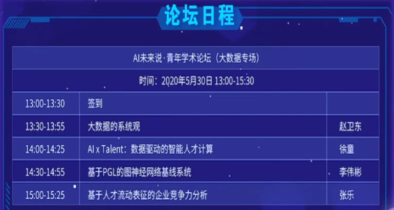
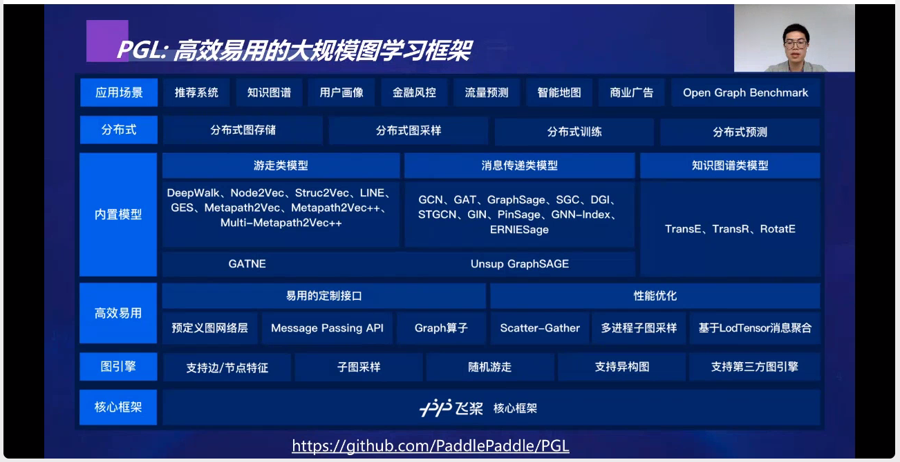

<!-- MarkdownTOC levels="1,2,3" autolink="true" autoanchor="true" -->

- [AI未来说-青年学术论坛\(大数据专场\)](#ai%E6%9C%AA%E6%9D%A5%E8%AF%B4-%E9%9D%92%E5%B9%B4%E5%AD%A6%E6%9C%AF%E8%AE%BA%E5%9D%9B%E5%A4%A7%E6%95%B0%E6%8D%AE%E4%B8%93%E5%9C%BA)
    - [基本信息](#%E5%9F%BA%E6%9C%AC%E4%BF%A1%E6%81%AF)
    - [讲座详情](#%E8%AE%B2%E5%BA%A7%E8%AF%A6%E6%83%85)
        - [大数据的系统观-赵卫东-复旦大学计算机科学技术学院副教授](#%E5%A4%A7%E6%95%B0%E6%8D%AE%E7%9A%84%E7%B3%BB%E7%BB%9F%E8%A7%82-%E8%B5%B5%E5%8D%AB%E4%B8%9C-%E5%A4%8D%E6%97%A6%E5%A4%A7%E5%AD%A6%E8%AE%A1%E7%AE%97%E6%9C%BA%E7%A7%91%E5%AD%A6%E6%8A%80%E6%9C%AF%E5%AD%A6%E9%99%A2%E5%89%AF%E6%95%99%E6%8E%88)
        - [AI×Talent数据驱动的智能人才计算-徐童-中国科学技术大学副教授&硕士生导师](#ai%C3%97talent%E6%95%B0%E6%8D%AE%E9%A9%B1%E5%8A%A8%E7%9A%84%E6%99%BA%E8%83%BD%E4%BA%BA%E6%89%8D%E8%AE%A1%E7%AE%97-%E5%BE%90%E7%AB%A5-%E4%B8%AD%E5%9B%BD%E7%A7%91%E5%AD%A6%E6%8A%80%E6%9C%AF%E5%A4%A7%E5%AD%A6%E5%89%AF%E6%95%99%E6%8E%88%E7%A1%95%E5%A3%AB%E7%94%9F%E5%AF%BC%E5%B8%88)
        - [基于PGL的图神经网络基线系统-李伟彬-百度自然语言处理部研发工程师](#%E5%9F%BA%E4%BA%8Epgl%E7%9A%84%E5%9B%BE%E7%A5%9E%E7%BB%8F%E7%BD%91%E7%BB%9C%E5%9F%BA%E7%BA%BF%E7%B3%BB%E7%BB%9F-%E6%9D%8E%E4%BC%9F%E5%BD%AC-%E7%99%BE%E5%BA%A6%E8%87%AA%E7%84%B6%E8%AF%AD%E8%A8%80%E5%A4%84%E7%90%86%E9%83%A8%E7%A0%94%E5%8F%91%E5%B7%A5%E7%A8%8B%E5%B8%88)
        - [基于人才流动表征的企业竞争力分析-张乐-中国科学技术大学在读博士生](#%E5%9F%BA%E4%BA%8E%E4%BA%BA%E6%89%8D%E6%B5%81%E5%8A%A8%E8%A1%A8%E5%BE%81%E7%9A%84%E4%BC%81%E4%B8%9A%E7%AB%9E%E4%BA%89%E5%8A%9B%E5%88%86%E6%9E%90-%E5%BC%A0%E4%B9%90-%E4%B8%AD%E5%9B%BD%E7%A7%91%E5%AD%A6%E6%8A%80%E6%9C%AF%E5%A4%A7%E5%AD%A6%E5%9C%A8%E8%AF%BB%E5%8D%9A%E5%A3%AB%E7%94%9F)

<!-- /MarkdownTOC -->

# AI未来说-青年学术论坛(大数据专场)

## 基本信息
“AI未来说·青年学术论坛”系列讲座由中国科学院大学主办，百度全力支持，读芯术、paperweekly作为合作自媒体。承办单位为中国科学院大学学生会，协办单位为中国科学院计算所研究生会、网络中心研究生会、人工智能学院学生会、化学工程学院学生会、公共政策与管理学院学生会、微电子学院学生会。2020年5月30日，第15期“AI未来说·青年学术论坛”大数据线上专场论坛以“线上平台直播+微信社群图文直播”形式举行。

## 讲座详情

### [大数据的系统观-赵卫东-复旦大学计算机科学技术学院副教授](https://mp.weixin.qq.com/s?__biz=MzI2NjkyNDQ3Mw==&mid=2247493451&idx=2&sn=aad8dcfdebc6153d73c6ffdf3742bdfc&chksm=ea841f9dddf3968bcf3d461e9928eb996604baa2008352c3592e40f38da465dfab1ff4fdf107&mpshare=1&scene=1&srcid=&sharer_sharetime=1591245063302&sharer_shareid=5efe7392522068a36357738fc006bcbd&key=e9c470df1356d7408e3a498fa6d4821da86a5cdbb5a4148797cf96449e7887d9c1986fb17a805a0f25c36c99250123691a3573abdbe133a177ed22f15beeb1d70ec0126cf038ec376d89fa24f66915e3&ascene=1&uin=NzM5MTc3ODA5&devicetype=Windows+10+x64&version=62090070&lang=zh_CN&exportkey=A8Fo4bmwlHiP2%2B0d4B3foB4%3D&pass_ticket=3U%2BHaDkidZRsViH9KrJ2CS%2BQ1mbixpO0u1nr59R98GSkWrnsjzewiGI2afOssIq%2B)

- __主要内容__：大数据的价值发挥在实际中需要融合很多源头的动态数据，但由于隐私、政策、制度和技术的局限，使现存的大数据只能作为小数据使用，降低了大数据在决策中的作用。结合新冠肺炎的应急预测预警等应用场景，讨论如何利用系统观认识大数据的使用。
- __推荐度__：●●○○○
- __个人感想__：内容有点散or乱，主要从宏观上说了一些大数据当前存在的问题，比如如何处理大数据（利用大数据与小数据的相似性和分而治之的思想，把大数据转化成小数据，借用成熟的小数据处理技术对大数据进行处理）、大数据的获取（利用爬虫等其实也并不能获取所有的数据）、大数据的复杂性（数据来源以及结构的多台）、AI在大数据的应用（深度学习的效果可能还不如传统的机器学习，人机融合），偏向科普。

### [AI×Talent数据驱动的智能人才计算-徐童-中国科学技术大学副教授&硕士生导师](https://mp.weixin.qq.com/s?__biz=MzI2NjkyNDQ3Mw==&mid=2247493482&idx=2&sn=fa3108e25f5bd047bf837c32dcb83727&chksm=ea841fbcddf396aaeace5aa1d2368cd651d7038f0c846b2bc2b4c0cd9d9f5dc25f232fb42255&mpshare=1&scene=1&srcid=&sharer_sharetime=1591349956574&sharer_shareid=5efe7392522068a36357738fc006bcbd&key=cfdc8c44c2e4b1cfdafccd18c2ae72a3adaaa480360b0a9c68b1453294402a9f0c97390731e2327d4326d23ad8a4994def856df04408f7e8904f5c849ea35824402e07f4cec817ae2d8f8a9dc47eed70&ascene=1&uin=NzM5MTc3ODA5&devicetype=Windows+10+x64&version=62090070&lang=zh_CN&exportkey=AzhLsMuBMsnWB1X%2BDNFTxe4%3D&pass_ticket=3U%2BHaDkidZRsViH9KrJ2CS%2BQ1mbixpO0u1nr59R98GSkWrnsjzewiGI2afOssIq%2B)

- __主要内容__：大数据时代的来临为传统的人才管理战略带来了冲击，其低效率、主观化、缺乏可预测性的问题日益凸显。与此同时，数据科学的发展，也为破解这一困境提供了新的思路与手段。在本次报告中，将简要回顾智能人才分析方面的若干成果，即运用数据挖掘技术，揭示海量人才管理相关数据中潜藏的规律，并解决与人才招聘相关的岗位匹配、发展预测等一系列难题。
- __推荐度__：●●●●●
- __个人感想__：应该是第一次听智能人才计算这个领域的东西，虽然通俗的讲就是人才招聘，但感觉很有意思。报告里说到，由于现有人才管理的模式，仍然倾向于人工，导致海量数据处于沉睡状态，而如果把其与AI结合，会产生更加高效和公平的招聘模式，企业更能找到想要的员工，人也更能找到合适的工作。针对简历同质化严重、简历个性化表述、招聘者主观性干扰的问题，他们团队研究了在招聘过程中的招聘助手、岗位分配过程中的人岗匹配、以及在人才管理中的高潜力人才与预测的三方面工作。

### [基于PGL的图神经网络基线系统-李伟彬-百度自然语言处理部研发工程师](https://mp.weixin.qq.com/s?__biz=MzI2NjkyNDQ3Mw==&mid=2247493485&idx=2&sn=256a212e3f27ff5855686fdc02c7c92f&chksm=ea841fbbddf396ad329077af8f26a29cf3c66272e52851feaf8ead85adec17ad4d654479bd1d&mpshare=1&scene=1&srcid=&sharer_sharetime=1591419120264&sharer_shareid=d403ad6fd93dc8472c18db972e93df18&key=8d9e1ac2792cb89ffa540764a8f16424139dce7751c1fea962bfad9e88b5085898685e06059b93badf61b757d470e4908143c127a994f61d838ebd82f81542fbb071ad85cbb046da2ffc3542916a7487&ascene=1&uin=NzM5MTc3ODA5&devicetype=Windows+10+x64&version=62090070&lang=zh_CN&exportkey=Ay6%2FBr2%2FJe5WKGRE%2FK%2BC1mQ%3D&pass_ticket=3U%2BHaDkidZRsViH9KrJ2CS%2BQ1mbixpO0u1nr59R98GSkWrnsjzewiGI2afOssIq%2B)
- __主要内容__：传染病的有效防治是全人类面临的共同挑战，如何通过大数据，特别是数据的时空关联特性，来精准预测传染病的传播趋势和速度，将有助于人类社会控制传染病，保障社会公共卫生安全。而数据上的空间关联特性，恰好是图神经网络所擅长的。图神经网络在非结构化数据上有着出色的处理能力，使得最近一段时间图神经网络在学界与工业界上大放光彩。因此，本次分享将介绍2020国际大数据比赛中，基于百度飞桨推出的图学习框架Paddle Graph Learning(PGL)实现的基线系统。
- __推荐度__：●●●●○
- __个人感想__：在听之前以为要讲百度自己研发的什么系统，结果一听才发现是在介绍一个比赛，题目是高致病性串扰并的传播趋势预测，就是介绍用他们的图学习框架PGL开发了一个baseline系统，希望参赛者在这个baseline系统上尽可能的优化效果。简单介绍了图神经网络、PGL原理及其baseline系统，虽然有种打广告的感觉，但还是有点干货，有点意思。
- __不错的图__：

### [基于人才流动表征的企业竞争力分析-张乐-中国科学技术大学在读博士生](https://mp.weixin.qq.com/s?__biz=MzI2NjkyNDQ3Mw==&mid=2247493488&idx=2&sn=91a5cc28106eaf0bf366582ccf600255&chksm=ea841fa6ddf396b06293c22e18508945c314fb5682cdcf0a2a762839cf08109280590987e413&mpshare=1&scene=1&srcid=&sharer_sharetime=1591504042889&sharer_shareid=5efe7392522068a36357738fc006bcbd&key=3ac95d4b2b523f660c53c286667c0dd3f045fc658759bbc7c44137164dd1528cbd8ca5140f99e61a4d605118c236dc39fd2658ae10c7847d1b9e6ad1dd2e447ce0c20cc23f17ffea31fed76e534fe408&ascene=1&uin=NzM5MTc3ODA5&devicetype=Windows+10+x64&version=62090070&lang=zh_CN&exportkey=A56Tv5HjuWKRzZ02HCss2To%3D&pass_ticket=3U%2BHaDkidZRsViH9KrJ2CS%2BQ1mbixpO0u1nr59R98GSkWrnsjzewiGI2afOssIq%2B)

- __主要内容__：在高速发展的商业环境下，企业间的竞争变得越来越激烈，对于企业竞争力分析的应用有着迫切的需求。而人才流动已经成为当下普遍存在的现象，其背后折射着企业之间的竞争关系，本报告将从人才流动的角度介绍一种企业竞争力分析方法。
- __推荐度__：●●●○○
- __个人感想__：主要分享了他在WWW2020上发表的1篇论文，通过分析人才流动来研究企业间的竞争，和前面徐童老师的内容有点沾边，不过这里是以企业为对象研究他们之间的竞争关系，到底是竞争还是合作。他的数据搜集是从领英得到某个人的几段工作经历及时间，构造类似公司跳槽转移有向图，利用pagerank(PPR)计算跳槽的可能性，计算原始图和转移图的PPR来描述公司a对公司b的竞争力大小。论文报告里公式有点多，不过他讲得倒是比较清楚，最后的结论也有一点意思。

