<!-- MarkdownTOC levels="1,2,3" autolink="true" autoanchor="true" -->

- [200812-BCS2020-互联网基础资源论坛-上](#200812-bcs2020-%E4%BA%92%E8%81%94%E7%BD%91%E5%9F%BA%E7%A1%80%E8%B5%84%E6%BA%90%E8%AE%BA%E5%9D%9B-%E4%B8%8A)
    - [1. 根服务器系统简介-ICANN CTO办公室首席技术专家-Paul Hoffman](#1-%E6%A0%B9%E6%9C%8D%E5%8A%A1%E5%99%A8%E7%B3%BB%E7%BB%9F%E7%AE%80%E4%BB%8B-icann-cto%E5%8A%9E%E5%85%AC%E5%AE%A4%E9%A6%96%E5%B8%AD%E6%8A%80%E6%9C%AF%E4%B8%93%E5%AE%B6-paul-hoffman)
    - [2. RSSAC与根服务器系统-ICANN互联网根服务器系统咨询委员会\(RSSAC\)主席-Fred Baker](#2-rssac%E4%B8%8E%E6%A0%B9%E6%9C%8D%E5%8A%A1%E5%99%A8%E7%B3%BB%E7%BB%9F-icann%E4%BA%92%E8%81%94%E7%BD%91%E6%A0%B9%E6%9C%8D%E5%8A%A1%E5%99%A8%E7%B3%BB%E7%BB%9F%E5%92%A8%E8%AF%A2%E5%A7%94%E5%91%98%E4%BC%9Arssac%E4%B8%BB%E5%B8%AD-fred-baker)
    - [3. 阿里云DNS打造安全稳定的数字经济基础设施-阿里云高级网络架构师-宋林健](#3-%E9%98%BF%E9%87%8C%E4%BA%91dns%E6%89%93%E9%80%A0%E5%AE%89%E5%85%A8%E7%A8%B3%E5%AE%9A%E7%9A%84%E6%95%B0%E5%AD%97%E7%BB%8F%E6%B5%8E%E5%9F%BA%E7%A1%80%E8%AE%BE%E6%96%BD-%E9%98%BF%E9%87%8C%E4%BA%91%E9%AB%98%E7%BA%A7%E7%BD%91%E7%BB%9C%E6%9E%B6%E6%9E%84%E5%B8%88-%E5%AE%8B%E6%9E%97%E5%81%A5)
    - [4. DNS加密协议发展及部署现状-清华大学网络研究院博士后-刘保君](#4-dns%E5%8A%A0%E5%AF%86%E5%8D%8F%E8%AE%AE%E5%8F%91%E5%B1%95%E5%8F%8A%E9%83%A8%E7%BD%B2%E7%8E%B0%E7%8A%B6-%E6%B8%85%E5%8D%8E%E5%A4%A7%E5%AD%A6%E7%BD%91%E7%BB%9C%E7%A0%94%E7%A9%B6%E9%99%A2%E5%8D%9A%E5%A3%AB%E5%90%8E-%E5%88%98%E4%BF%9D%E5%90%9B)
    - [5. 区块链域名数据分享开源项目-伏羲智库CTO-王伟](#5-%E5%8C%BA%E5%9D%97%E9%93%BE%E5%9F%9F%E5%90%8D%E6%95%B0%E6%8D%AE%E5%88%86%E4%BA%AB%E5%BC%80%E6%BA%90%E9%A1%B9%E7%9B%AE-%E4%BC%8F%E7%BE%B2%E6%99%BA%E5%BA%93cto-%E7%8E%8B%E4%BC%9F)
    - [6. “数”说疫情（DNS数据展示与Passive DNS建设的几点体会）-中国电信云堤，高级研发工程师-余启明](#6-%E2%80%9C%E6%95%B0%E2%80%9D%E8%AF%B4%E7%96%AB%E6%83%85%EF%BC%88dns%E6%95%B0%E6%8D%AE%E5%B1%95%E7%A4%BA%E4%B8%8Epassive-dns%E5%BB%BA%E8%AE%BE%E7%9A%84%E5%87%A0%E7%82%B9%E4%BD%93%E4%BC%9A%EF%BC%89-%E4%B8%AD%E5%9B%BD%E7%94%B5%E4%BF%A1%E4%BA%91%E5%A0%A4%EF%BC%8C%E9%AB%98%E7%BA%A7%E7%A0%94%E5%8F%91%E5%B7%A5%E7%A8%8B%E5%B8%88-%E4%BD%99%E5%90%AF%E6%98%8E)

<!-- /MarkdownTOC -->

# 200812-BCS2020-互联网基础资源论坛-上

* [日程安排](https://bcs.qianxin.com/2020/meetings/index?meeting_time=2020-08-12)
* [直播回放](https://bcs.qianxin.com/2020/live/index?meeting_id=18)

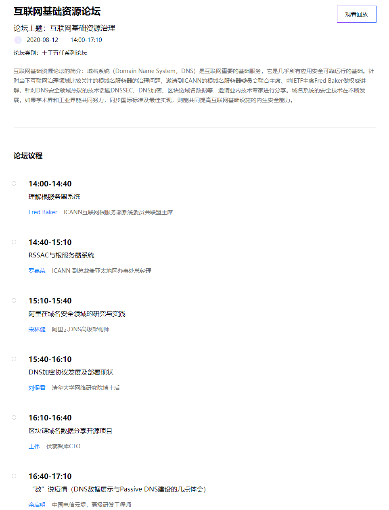

## 1. 根服务器系统简介-ICANN CTO办公室首席技术专家-Paul Hoffman

- __主要内容__：整体内容围绕互联网根服务器系统展开，利用5W1H的方式，按 what who why how where when 的顺序依次介绍根服务器系统的情况。
    + __What__ 介绍了根区文件包含的内容，即所有的顶级域TLDs及其对应的NS服务器信息，以及DNSSEC的数字签名记录，同时 __根区文件每天均会进行若干次的同步和更新__ （每天都会更新，这个更新频率有点意外）。同时介绍了一些名称术语，如 __根区文件__ (Root zone)、__根服务器运行管理机构__ (Root server operator, RSO)、__根服务器标识符__ (Root server identifier)、__根服务器系统__ (Root server system, RSS)，更多细节参考[RSSAC026v2: RSSAC Lexicon - ICANN](https://www.icann.org/en/system/files/files/rssac-026-lexicon-12mar20-en.pdf)
    + __Who__ 介绍了前面提到的一些专业术语指代的对象，如RSO，12个RSO __在各自运营自身的根服务器上保持高度独立__ （选择服务器类型、DNS软件、节点部署位置等），都 __一致同意只接受由IANA所提供的的数据作为根区文件内容__ 。以及根域名服务器所面向的用户群体，也就是 __互联网运行商以及组织机构所维护__ 的数以百万计的 __递归解析服务器__ ；__存在少量用户拥有自己专用的递归解析服务器__ ，但占比极少。
    + __Why__ 介绍了运行管理根服务器的原因，12家RSO的原因各不相同，但大部分是为了互联网更有弹性、更稳定，都承诺会为数以百万计的递归解析服务器提供可靠的域名解析服务，提供一致、正确的应答响应内容。
    + How介绍了根服务器具体部署实施的情况，当前有13个根服务器标识符，每个都有对应的IPv4和IPv6地址，超过1000+个根服务器节点，每个RSO都会采用 __anycast任播技术__ 使得虽然采用完全相同的主机地址，但在全世界各地部署多个节点instance，而且由于每个RSO高度独立，其各自部署的节点个数也各不相同。以及如何保障根区文件的安全方法，也即是DNSSEC签名机制，2018年根区文件签名的密钥首次更新，目前 __绝大多数顶级域支持DNSSEC签名__ ，但当前 __部署DNSSEC的递归解析器比例仍较低__ ，__约仅有三分之一的互联网用户能够从DNSSEC中获益__（好奇这个1/3是怎么估计出来的）
    + __Where__ 介绍了具体根服务器节点的位置，包括各个大小城市甚至岛屿，[交互式地图](https://root-servers.org/)可查看具体位置，当前已有的1000+节点 __基本__ 能够 __满足__ 对所有递归解析服务器的域名解析 __需求__ ，不至于对终端用户产生较大的网络延迟，并且众多的根服务器节点 __有利于应对DDoS__，会把攻击流量分散到不同服务器节点上。
    + __When__ 介绍了根服务器系统过去的35年[历史](https://www.icann.org/en/system/files/files/rssac-023-17jun20-en.pdf)，2002年才开始使用anycast任播技术扩大了13个根服务器数量的限制。以及当前和未来展望，RSS运行OK，节点规模持续增长，新增DNSSEC数据签名规模也在增长，并在制定未来如何治理RSS的方案。
- __推荐度__：●●●●○
- __个人感想__：首先，不知道是会务组还是 Paul Hoffman 自己 or ICANN 准备的，观众看到的PPT是全中文的，但是Paul Hoffman汇报是全英文汇报，边听边看边理解，感觉非常照顾中国听众，很有心。其次，对于整体的内容，算是一次科普性的内容，比较完整的对根服务器系统的一些关键点进行了简要介绍，还是比较推荐的。

## 2. RSSAC与根服务器系统-ICANN互联网根服务器系统咨询委员会(RSSAC)主席-Fred Baker

- __主要内容__：介绍互联网域名系统根服务器的架构和运行管理机制等，可以说是对上一个报告中进行更为细粒度的讲解，以及RSSAC在整个RSS中所承担的职责和作用。
    + 首先介绍根服务器系统咨询委员会(RSSAC)扮演的角色，实际上RSSAC是ICANN下的一个小组，主要负责提供关于域名系统根服务器相关的咨询和建议。之所以选择这些人/机构作为小组的成员，是因为他们就是互联网根服务器的创始者，早在ICANN成立之前，就十分活跃。而ICANN想要建立一个沟通渠道，把ICANN社群和董事会以及根服务器运营者联系在一起。RSSAC关注的领域实际上十分狭窄，只对RSS的工作机制以及如何使其更好的服务ICANN社群这类问题感兴趣
    + 其次介绍一些与ICANN相关的内容。包括ICANN社群的情况，一共由10个组织or咨询委员会组成，用文档形式进行交流，和不同的RSO一起讨论某些议题；RSS的历史，从最开始4个IP地址逐渐变成13个IP地址；介绍当前根服务器系统架构，包括域名、RSOs等（这里提到 __有一些机构属于美国军方的组织__ ，比如第9个美国国防部网络信息中心，并不能算是公司or企业，这类组织需要单独对待）；介绍整体RSS的根区管理流程，需要明确的是，RSSAC只是做了其中的一小部分工作；介绍当前已有的对原始DNS的关键改进，一个是DNSSEC数字签名技术来保障域名系统的安全性，一个是anycast技术来分配共享IP提高弹性、降低延迟和抵抗DDoS攻击；对一些谣言进行了辟谣（这里有一些谣言有点意思，见后图）
    + 然后开始详细介绍RSS的演进过程。开了一系列的研讨会，最终提出了一个域名根服务器系统治理模型提案 [RSSAC037 官方英文版](https://www.icann.org/en/system/files/files/rssac-037-15jun18-en.pdf) [阿里云开发者社区中文版](https://developer.aliyun.com/article/764801)。提出RSS依据的11条原则，对每条原则进行了简要解释。其中第10条特别强调说RSOs是高度独立的，并不是由美国政府来运作，虽然的确有一些机构属于美国政府，但是要求RSOs必须保持中立和公正。介绍了RSS的顶层设计理念，希望做到避免利益冲突、做到职能分离以及最大限度的透明、可审计。依次介绍治理结构的每个部门及其职能，详细可看 RSSAC037 ，主要包括战略、架构与政策功能SAPF、财务功能FF、授权与撤销RSO功能DRF、性能监测与测量功能PMMF以及秘书处功能SF。
    + 最后介绍当前最近2020.1月组建的治理工作组GWG及其组成机构，负责解释RSS治理模式的变化并向ICANN董事会呈交建议。
- __推荐度__：●●●○○
- __个人感想__：首先，这个汇报的PPT是全英文，但是演讲者的汇报居然有中文翻译，不确定是实时翻译还是录播配的字幕（倾向是录播）。其次，整个报告的大部分内容都是之前不太了解的，并不是讲解具体的技术，更多的是介绍人为、管理相关的东西，整体感觉流程还是比较复杂，算是扩大了视野，大概了解RSSAC和ICANN的职能，以及他们管理RSS的原则、精神。不过如果不是特别感兴趣or想要深入研究的话，不是特别推荐。
- __不错的图__：

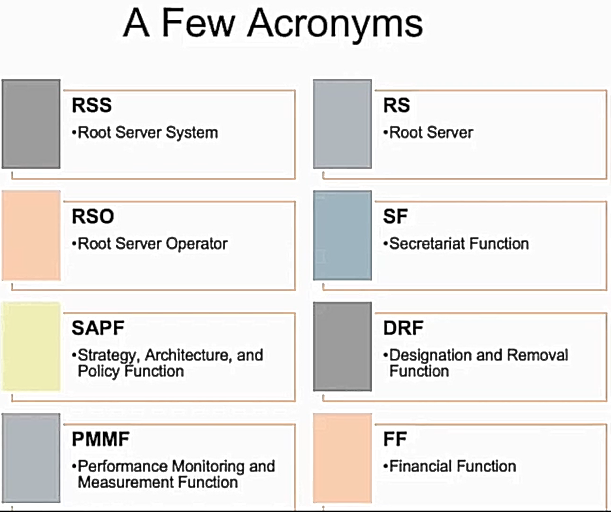
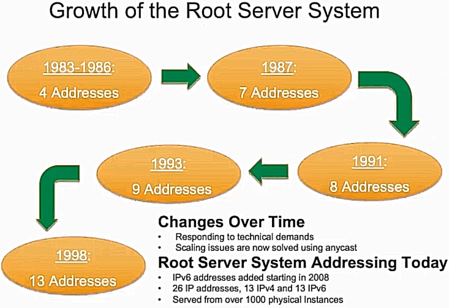
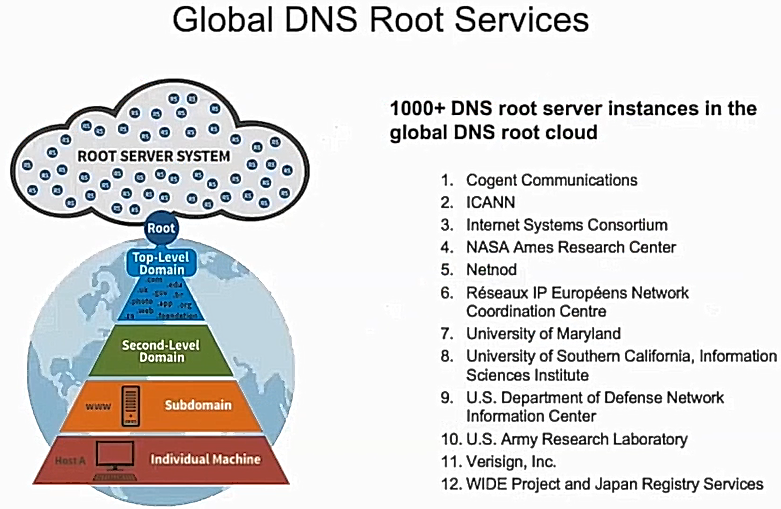
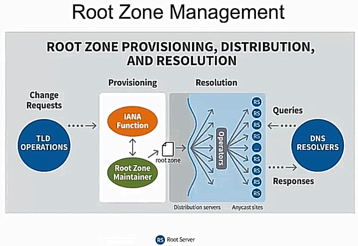
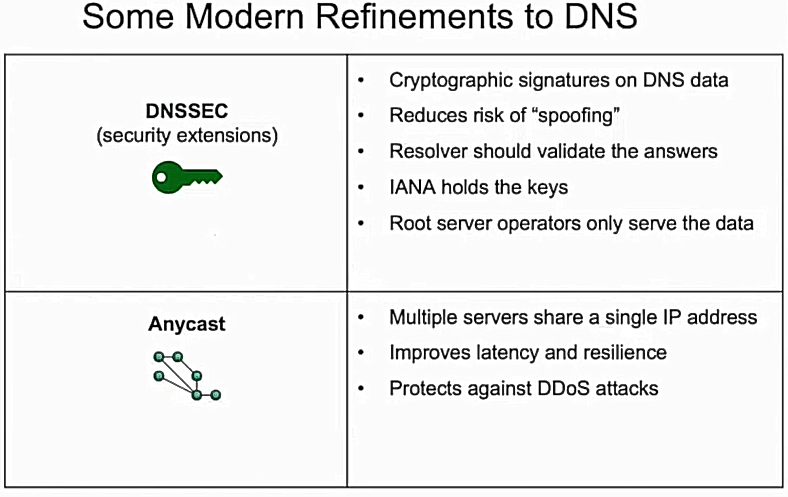
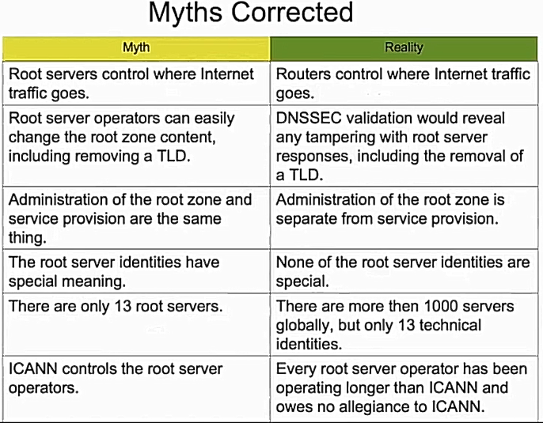
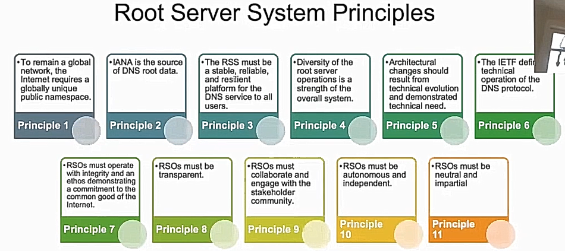
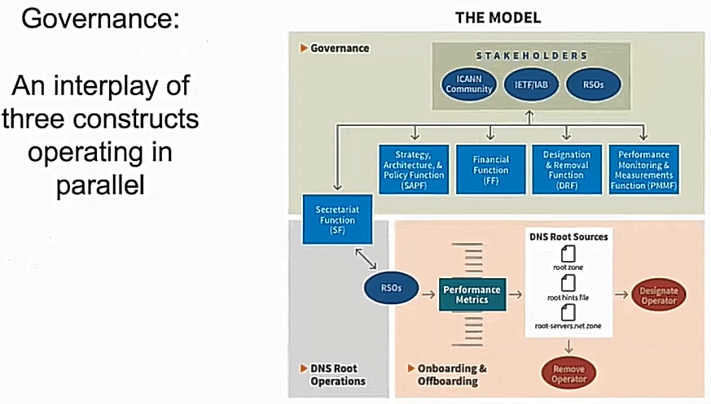
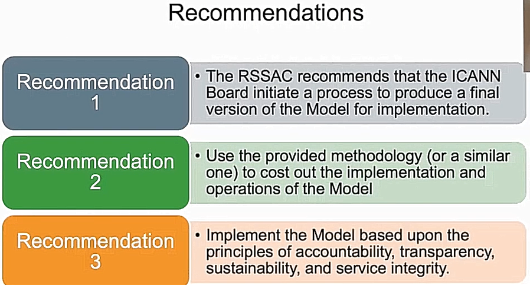
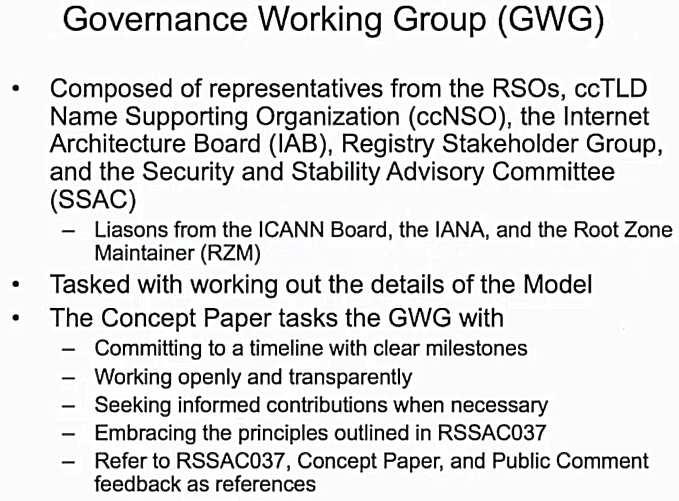
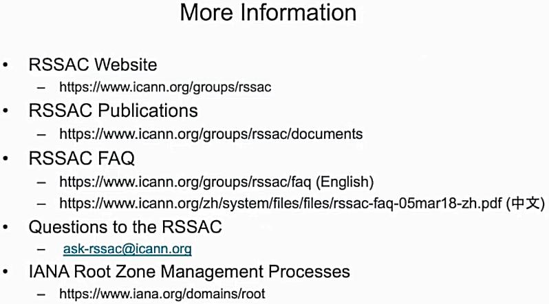

## 3. 阿里云DNS打造安全稳定的数字经济基础设施-阿里云高级网络架构师-宋林健

- __主要内容__：报告分为3个部分，首先概述DNS解析的基本概念、技术趋势和热点，然后介绍阿里云安全DNS上的解决方案与实践，最后对整体进行小结。
    + 首先，在基本概念、趋势和热点部分，从近年来的安全事件开始引入，强调DNS的重要性，介绍DNS功能和角色的演进，特别是在近些年 __在其他领域如移动互联网、云计算、IoT物联网、互联网治理和政策（根服务器自治等）上，对DNS提出了新的需求__ ，点出了当前最热的DNS加密和隐私保护的情况。
    + 其次，介绍了阿里云解析DNS的能力（有点产品发布会的意思了），从阿里云DNS整体的基本功能、安全能力、业务节点分布、支持DNSSEC等情况进行介绍；然后介绍公共DNS提供免费的DNS加密解析服务（这里比较有趣的是， 他们发现 __流量中90%+都是DoT的__ ，剩下的才是DoH的，他们推测是因为安卓生态对DoT的支持，安卓手机提供了直接配置DoT的选项，一些第三方的插件安卓也支持使用DoT的接口，所以导致DoT的流量更多）；然后介绍他们面向智能终端toB的版本（这里比较有趣的是，由于他们阿里云承担了据说48%的权威域名服务器，所以他们直接建立了他们自身的公共递归解析器与他们自己的权威DNS的一个联动刷新机制，__权威DNS会主动推送信息到公共的递归解析器__，使得用户获取DNS解析更为快捷）；然后介绍他们通过阿里云公共DNS+云解析DNS+全局流量管理+高防IP的搭配使用，提高了整体对DDoS攻击的防护能力；最后介绍阿里在根服务器方面的工作，他们引入了一个根镜像在杭州（测试引入根镜像能够有效减少根区访问延迟，跨洋>200ms，跨国>50ms，国内ISP 10~50ms，同region <5ms），简单介绍了一些根服务器去中心化的讨论以及阿里云他们对根服务器问题的一些思考，考虑可以通过简历全国备案的递归域名服务器组成联盟，直接与国内域名注册局和DNS服务商进行数据联动，无需访问根服务器，或者尽量推广.cn域名的注册和使用以实现国内域名解析的“内循环”。
- __推荐度__：●●●●○
- __个人感想__：虽然听起来挺像产品发布会的，但是感觉内容还是有点意思，而且阿里的确是很强，双十一的流量、能够引入一个根镜像，都不是其他公司能做到的。
- __不错的图__：

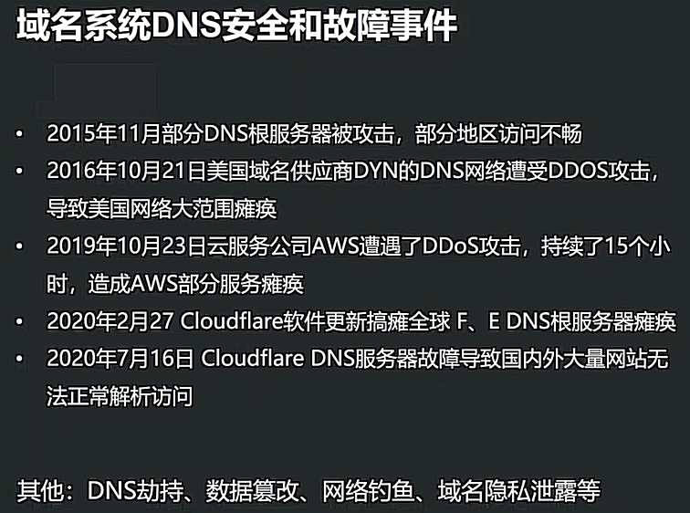
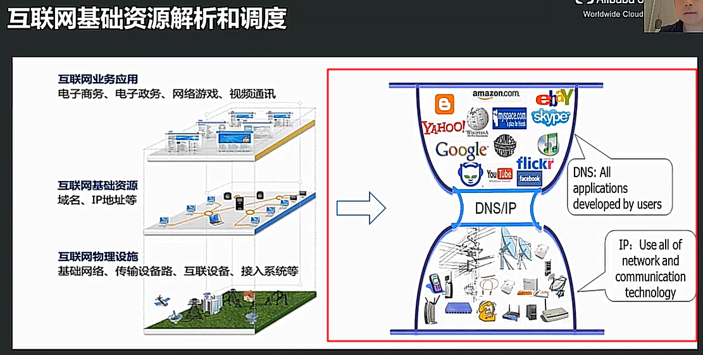
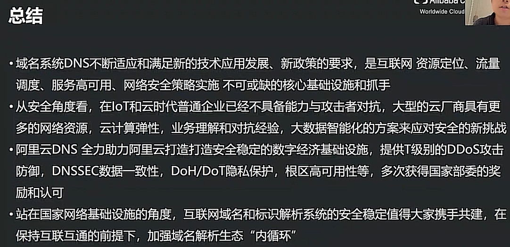

## 4. DNS加密协议发展及部署现状-清华大学网络研究院博士后-刘保君

* **主要内容**：介绍发表在 IMC' 19上的工作：*[An End-to-End, Large-Scale Measurement of DNS-over-Encryption: How Far Have We Come?](https://conferences.sigcomm.org/imc/2019/program#p90)* 介绍DNS加密（DNS-over-Encryption）生态的研究内容，重点关注目前 IETF 已经标准化的两个协议 **DoT** 和 **DoH**。从用户的角度出发，依次回答 **DoE 部署现状、可用性和流量规模** 三个问题：

  1. **Q1：全球有多少DNS服务器支持加密服务，安全现状如何？（部署现状）**
     * Methodology：对于 DoT，可使用简单的端口扫描探测；而 DoH 由于443端口共享，无法通过端口探测识别区分 DoH 服务，由于大型厂商会使用常见的 URL 模板，考虑在大规模的 URL 数据集中尝试过滤寻找。
     * Results：
       * 2019.2~2019.5，发现了~2K DoT 解析器；2020.7 二次测量，发现了约7.8K解析器，归属于1.2K服务提供商。时间间隔一年，DoT 解析器数量猛增。
       * 2019年的测量发现 DoT 中存在大量的无效证书，~70%为自签发证书，~15%的证书为过期证书，~15%证书链缺失，难以验证。作者建议DoT服务提供商定期检查证书的配置及有效性。
       * 采用 URL 模板的方法识别的 DoH 解析器较少。截至 2019.5，只发现了17个服务提供商，大部分位于 curl DoH list，识别出2个列表之外的服务提供商；2020.7 发现了50+有效DNS URIs，归属于37个服务提供商，很多已经不在列表中，这些大多数是由大型公司或 ISP 运行并维护的。

  2. **Q2：支持加密的DNS服务器中，性能表现如何？数据加密过程是否会成为 DNS 服务器的性能瓶颈？（可用性）**
     * Methodology：在客户端侧构造定制的DNS请求，使用代理网络转发到出口节点，再转发到DNS解析服务器。使用2个代理网络，114k 测量节点，向 Google，cloudflare，Quad9 的 DNS公开解析服务器发送请求，检查失败节点是否能真正使用DoE。
     * Results：
       * ~99% 的加密DNS请求可达，比传统DNS请求失败率低。
       * cloudflare 的公开DNS解析服务器1.1.1.1 由于存在劫持事件，解析失败率比其他服务器高；Quad9 DoH 由于设置了较小的超时时间，解析失败率较高，已向厂商反馈解决；国内访问 Google DoE，失败率 ~99%。
       * 在连接复用的情况下，DoE 域名解析所带来的额外时延开销可忽略，平均为毫秒量级。

  3. **Q3：DNS加密的应用现状如何，是否已有真实的加密流量？（流量规模）**
     * Methodology：被动测量。DoT，检查853端口即可；DoH，观测特定域名在passive数据中的规模，间接反映使用情况。
     * Results：
       * 从国内某运营商获取约18个月的netflow流量。在2019年前，DoT流量很小，比传统DNS流量小2-3数量级，但增长迅速。对客户端IP的归类，发现存在集中&分散用户两种模式。
       * DoH 流量流向大型服务提供商，使用量在逐步增长。
       * 公开的报告：cloudflare，8% DNS请求为加密；Qihoo 360，DoH服务拥有超过1.2M用户。

  最后，从服务提供商（修正错误配置、更新）、使用者（加密优势宣传）、研究者（结果、代码开源）给出相关建议。DNS 加密不是完善的解决手段，存在侧信道，降级攻击等安全问题，在协议设计上仍需进一步的改进。在DNS加密的部署实践上，还有许多的工作需要推进。

* **推荐度**：●●●●○

* **个人感想**：DoE 的测量论文，获得了 IMC 2019 的最佳论文奖提名，去年讨论班菁菁也分享过。总的来说工作量挺大的，作者选择的测量的点、总结的问题也很合理、全面，值得借鉴。

## 5. 区块链域名数据分享开源项目-伏羲智库CTO-王伟

* **主要内容**：
  * 首先介绍了互联网基础资源、服务及分配模式，呈现出树状结构的业务体系和管理架构，可以自上而下做集中式、集权式的管控。而用户在访问互联网服务时，往往不完全遵循自顶向下的模式，更多的像是依赖一个第三方代理（如DNS解析，由本地rDNS代为查询）。
  * 而互联网基础资源的管理和服务是存在内在矛盾的。资源管理者希望遵循一个精确唯一的自顶向下逐级分配和控制原则，而第三方在到用户最后一公里服务时，存在本地管辖和商业利益诉求，需要兼顾用户体验和个性化需求定制，这个体系的整体目标是达到用户，资源管理者和第三方的权力平衡。
  * 接着介绍了域名协议及系统的诞生的过程，命名空间分级自治，DNS 协议设计初衷由于商业运行模式的不合理性受到了挑战。ICANN 注册局体系通过注册费盈利，运营商和服务提供商只能通过流量变现。RFC陆续产生了用户侧的域名协议扩展，以提高本地服务的能力和地位，便于提升用户体验。这些用户侧的技术不断挑战&解构现有的域名体系，促进去中心化多放共治的治理形态。
  * 域名生态呈现明显的权力与义务不对等：
    * 技术机理上，用户依赖于递归服务而非权威服务，承担了99%以上的商业负载；
    * 产业链条上，递归服务自成体系，游离于以域名注册服务业务为中心的商业链条之外；
    * 治理参与上，递归服务提供者在ICANN体系中参与度很低。
  * 之后介绍了互联网核心资源治理体系的再平衡思路，以递归服务为接入点突破现有体系利益格局：
    * 递归服务是面向终端用户实现最后一公里实际交付的主体；
    * 递归服务是实施当地网络治理政策和落实安全管控措施的抓手；
    * 以ISP为代表的递归服务者是撬动现有治理体系的重要杠杆。ISP已经是ICANN-ASO的生态利益相关方，也是IETF的重要成员类型。
  * 明确方向之后，讨论了实现思路。介绍了以区块链为技术手段探索AT-SSR的实现途径。用户可以从构造的mesh网中获取数据，政府可以在mesh网中下发相应的管理措施，透明发布后，由ISP自主决定是否采取某种安全策略。同时与ICANN的利益链条也相符。目前正在进行系统的原型开发，开源项目预计9月发布。
* **推荐度**：●●●●○
* **个人感想**：王伟博士介绍了很多深刻的观点，着重强调了递归解析服务的重要性，以递归为切入，重新思考域名解析体系的构成和治理，很值得借鉴&思考。报告主要侧重于现阶段存在问题的分析和梳理，可能由于系统整体尚在开发过程中，后面介绍具体系统的设计实现部分内容相对较少。

## 6. “数”说疫情（DNS数据展示与Passive DNS建设的几点体会）-中国电信云堤，高级研发工程师-余启明

* **主要内容：**
  * 首先介绍电信的 DNS 系统和数据。全国每个省份至少部署一套，请求侧>2千万次/s，响应侧每天在10亿级别，数据表现出明显的长尾效应（Top 100 二级域名超过全天请求侧的80%）。
  * 然后介绍了数据各行业分布情况，展示了疫情期间DNS访问的Top榜单。qq，快手，抖音位于榜首，也有许多对手机厂商域名的访问。
  * 之后分析了不同行业的域名访问情况，
    * 首先是视频行业，优质的互联网内容对在线的互联网内容流量有很强的拉动作用，整体上看，疫情对视频行业的影响不大。
    * 接下来是出行，疫情期间用户对火车、飞机、酒店站点的访问相对平时减少量很大。市内出行在4，5月份基本恢复到正常水平。市内出行影响相对较小，其次是火车。
    * 之后是生活，外卖类域名访问量柱形图整体为V形，影视行业一路下滑，7月份才有所提升。
    * 最后是工作类，在线办公域名访问量在3—5月份达到顶峰，相比2019年高了好几个量级。
  * 还分析了黑产的情况
    * 疫情补贴诈骗：发现了某 IP 地址存在诱导诈骗行为。
    * 博彩：域名解析到某CDN，发现该CDN上托管的几乎全为博彩网站。
  * 最后介绍了 DNS 系统建设过程中的坑。提出应该警惕拿来主义，开源框架应该根据不同业务场景，了解清楚优劣特性再决定使用。
* **推荐度**：●●●○○
* **个人感想**：主要介绍了对疫情期间的 DNS 数据分析，从域名的访问热门程度推断疫情对行业的影响，没有进一步的深层次分析。

